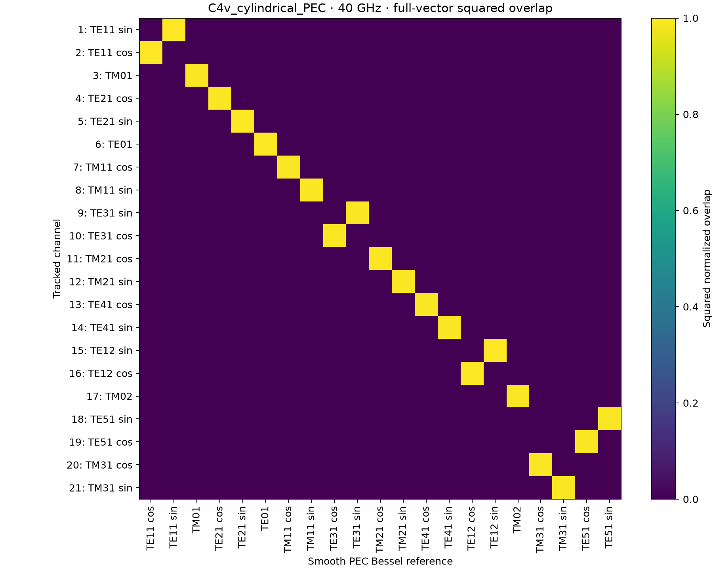
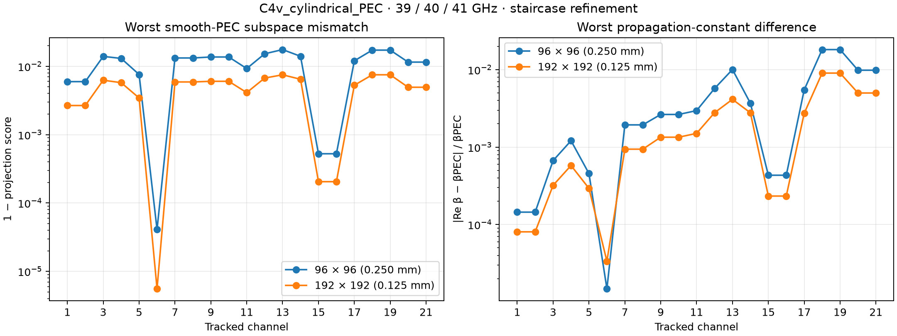
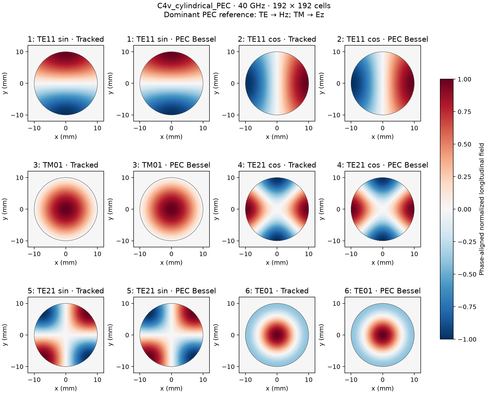
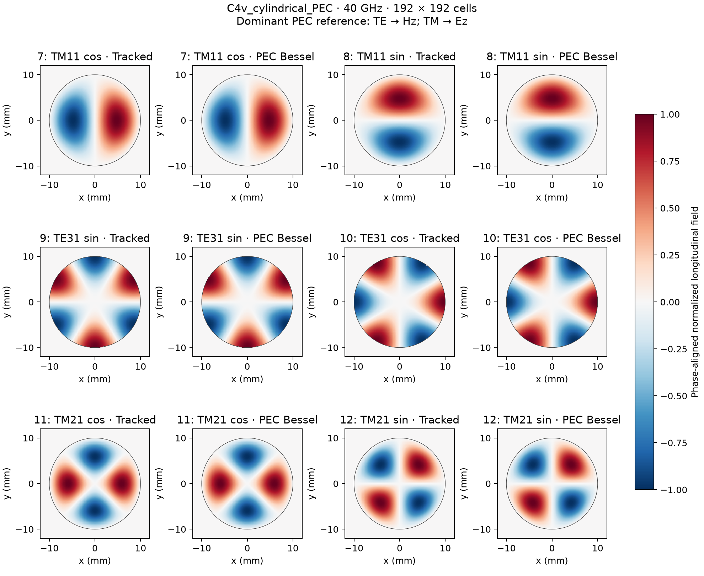
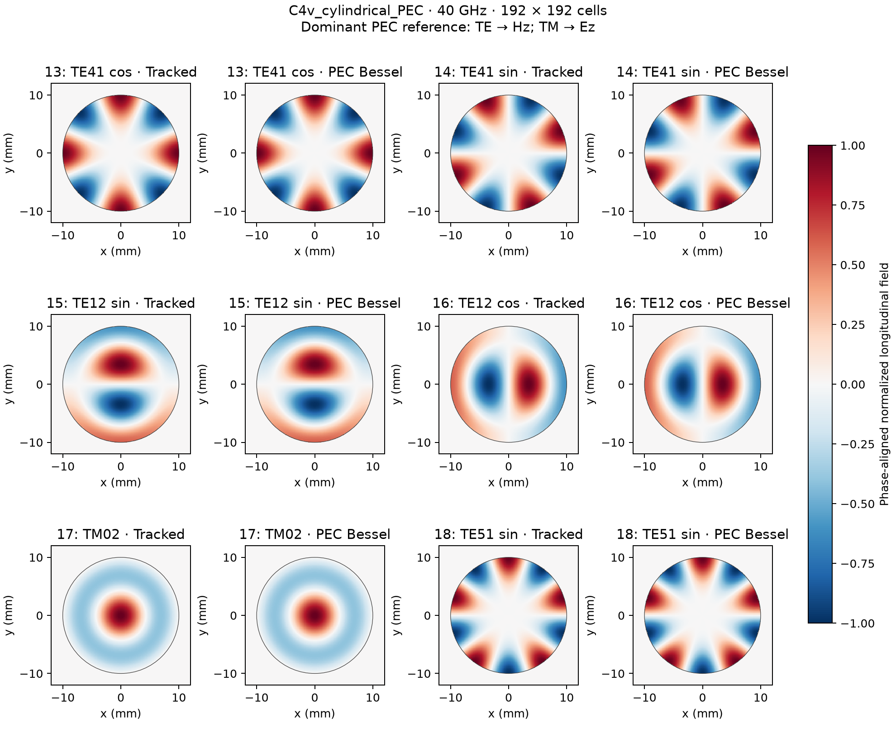
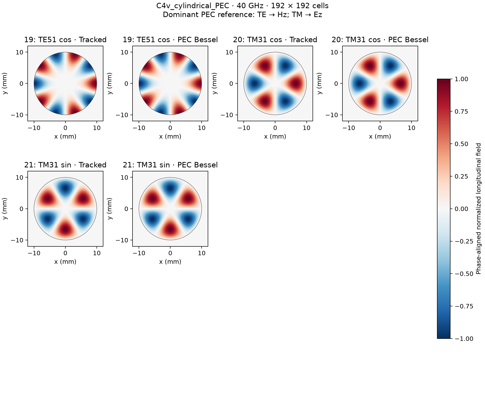
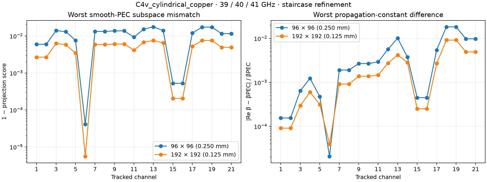
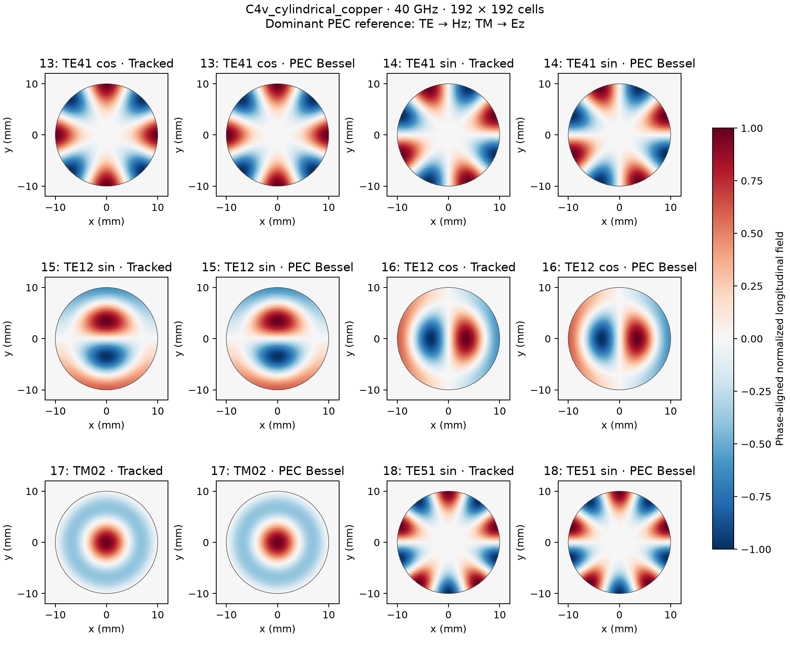

Cylindrical waveguides: PEC and copper modal profiles
================================================================================

Example 13 compares **21 automatically tracked modes** of an air-filled,
10-mm-radius cylindrical waveguide with smooth-cylinder Bessel solutions.
PEC and copper counterparts use anchors at 39, 40, and 41 GHz. There is no
excitation or time stepping. The circular voxel bore is centred in a 24-mm
square modal window with opaque padding, so its Cartesian staircase has
**C4v symmetry**. The analytical cylinder has continuous rotational symmetry.

The two meshes are 96 × 96 and 192 × 192 cells, giving transverse steps of
0.25 and 0.125 mm and 80 and 160 cells across the bore diameter. The finer
mesh is used for every field gallery and matching matrix below. These
meshes preserve the circular bore's centring and square-cell symmetry.

Analytical comparison and staircase effects
-------------------------------------------

The PEC reference profiles are

.. math::

   H_z = J_m(\chi'_{mn}r/R)\{\cos(m\phi),\sin(m\phi)\}
   \quad\text{for TE modes},

   E_z = J_m(\chi_{mn}r/R)\{\cos(m\phi),\sin(m\phi)\}
   \quad\text{for TM modes}.

Here χ′ and χ are zeros of J′ and J, respectively, and the m = 0 modes
have only the cosine member. Transverse fields are reconstructed from
Maxwell's equations with β² = (ω/c)² − (χ/R)², using the appropriate root.
All six components are sampled independently at native Yee locations.
The analytical field is zero outside the smooth bore, while the numerical
field retains its actual staircase support. **No near-wall samples are
excluded** from the comparison.

The matching matrices use the phase-invariant, normalized squared inner
product of [E, Z₀H], as defined in :doc:`waveguide_modal_validation`. Columns
are the smooth PEC references in analytical cutoff order; rows keep the
computed tracked-channel order. Thus an off-diagonal bright entry can
simply reflect a different channel order. Analytical profiles are used
only after tracking, to diagnose the computed fields.

The refinement metric projects each tracked field onto the complete
analytical equal-cutoff subspace. This includes both angular partners,
and the coincident TE01/TM11 family. It measures profile agreement without
penalizing a change of basis inside a smooth-cylinder degeneracy. The
field pictures show the dominant sine/cosine reference, using Hz for TE
and Ez for TM, after phase alignment and separate peak normalization.
All field components still enter the quantitative metric.

The grid can split angular partners that are degenerate in a smooth
circle: in particular, even-azimuthal-order partners need not belong to
the same C4v representation. Resolved eigenvalue splits are retained by
the tracking algorithm. For example, the PEC TE21 cosine/sine effective
index difference at 40 GHz decreases from 6.61 × 10⁻⁴ to 2.51 × 10⁻⁴
between these meshes. Staircase errors need not decrease monotonically
for every mode at every refinement, especially where different errors
cancel.

Copper uses conductivity 5.96 × 10⁷ S/m and a 16-term ADE surface-impedance
fit over 1–120 GHz, evaluated with a 0.99-Courant time step. The interior
modal operator uses continuous time and longitudinal propagation. The
validation constructs clipped Ampere contours on each air/metal face,
including convex and concave corners. Tests check the rectangular limit
against the existing boundary-row fixture and the retained stencil at a
concave corner.

Copper field plots use **PEC Bessel profiles as references**. The difference
therefore includes finite-conductivity effects as well as discretization.
The attenuation plots describe the staircased SIBC model; they do not
establish convergence to an independent smooth-cylinder attenuation formula.

Recorded results
----------------

The extrema below include all 21 modes and all three frequency anchors.
The propagation-constant error is :math:`|\operatorname{Re}\beta-\beta_{\rm PEC}|/\beta_{\rm PEC}`. Numerical residuals
are evaluated on the final tracked fields; their small size verifies the
discrete eigenproblem, while the Bessel comparison measures the separate
error relative to the smooth geometry.

.. list-table:: Double-precision CPU results
   :header-rows: 1

   * - Wall
     - Mesh
     - Minimum PEC-subspace overlap
     - Maximum β difference
     - Maximum Maxwell residual
   * - PEC
     - 96 × 96
     - 0.982437
     - 1.815%
     - 2.717e-13
   * - PEC
     - 192 × 192
     - 0.992486
     - 0.902%
     - 7.574e-12
   * - copper
     - 96 × 96
     - 0.982448
     - 1.828%
     - 5.134e-12
   * - copper
     - 192 × 192
     - 0.992494
     - 0.914%
     - 8.037e-12

On the finer mesh the minimum overlap exceeds 0.9924 for both materials.
Copper attenuation is finite and positive for every retained mode at every
anchor. The downloadable reports include complex effective indices,
per-channel overlaps and errors, copper attenuation, and source hashes.

Reproduce the examples
----------------------

Run from the repository root in the gprMax Python environment:

.. code-block:: console

   python examples/features/eigenmode_ports/example_13_C4v_cylindrical/tracked_modes.py --output results/cylindrical

This runs both PEC and copper. Use ``--wall PEC`` or ``--wall copper`` for
one material. ``--cells 96 192`` selects the refinement sequence; choose a
fresh output directory for each run. The implementation is
``testing/validation/cylindrical_modal_profiles.py``. It saves native complex
E/H fields (NPZ), tracking diagnostics and provenance (JSON), and every plot
shown below. Six extra candidates complete the modal search bank.

C4v cylindrical staircase: PEC
------------------------------

:download:`Recorded PEC results <../../testing/validation/C4v_cylindrical_PEC_results.json>`.

   PEC: full-vector matching of 21 tracked modes to smooth PEC Bessel profiles at 40 GHz on the 192 × 192 mesh.

   PEC: worst profile mismatch and relative propagation-constant difference across 39, 40, and 41 GHz on both meshes.

   PEC: modes 1–6 compared with their dominant analytical longitudinal components; the outline marks the smooth 10-mm-radius bore.

   PEC: modes 7–12 compared with their dominant analytical longitudinal components; the outline marks the smooth 10-mm-radius bore.

   PEC: modes 13–18 compared with their dominant analytical longitudinal components; the outline marks the smooth 10-mm-radius bore.

   PEC: modes 19–21 compared with their dominant analytical longitudinal components; the outline marks the smooth 10-mm-radius bore.

C4v cylindrical staircase: copper
---------------------------------

:download:`Recorded copper results <../../testing/validation/C4v_cylindrical_copper_results.json>`.

.. figure:: ../../images_shared/C4v_cylindrical_copper_matching.png
   :alt: copper: full-vector matching of 21 tracked modes to smooth PEC Bessel profiles at 40 GHz on the 192 × 192 mesh.
   :width: 100%

   copper: full-vector matching of 21 tracked modes to smooth PEC Bessel profiles at 40 GHz on the 192 × 192 mesh.

   copper: worst profile mismatch and relative propagation-constant difference across 39, 40, and 41 GHz on both meshes.

.. figure:: ../../images_shared/C4v_cylindrical_copper_attenuation.png
   :alt: Copper: computed attenuation at 40 GHz on both staircase meshes.
   :width: 100%

   Copper: computed attenuation at 40 GHz on both staircase meshes.

.. figure:: ../../images_shared/C4v_cylindrical_copper_profiles_1.png
   :alt: copper: modes 1–6 compared with their dominant analytical longitudinal components; the outline marks the smooth 10-mm-radius bore.
   :width: 100%

   copper: modes 1–6 compared with their dominant analytical longitudinal components; the outline marks the smooth 10-mm-radius bore.

.. figure:: ../../images_shared/C4v_cylindrical_copper_profiles_2.png
   :alt: copper: modes 7–12 compared with their dominant analytical longitudinal components; the outline marks the smooth 10-mm-radius bore.
   :width: 100%

   copper: modes 7–12 compared with their dominant analytical longitudinal components; the outline marks the smooth 10-mm-radius bore.

   copper: modes 13–18 compared with their dominant analytical longitudinal components; the outline marks the smooth 10-mm-radius bore.

.. figure:: ../../images_shared/C4v_cylindrical_copper_profiles_4.png
   :alt: copper: modes 19–21 compared with their dominant analytical longitudinal components; the outline marks the smooth 10-mm-radius bore.
   :width: 100%

   copper: modes 19–21 compared with their dominant analytical longitudinal components; the outline marks the smooth 10-mm-radius bore.
