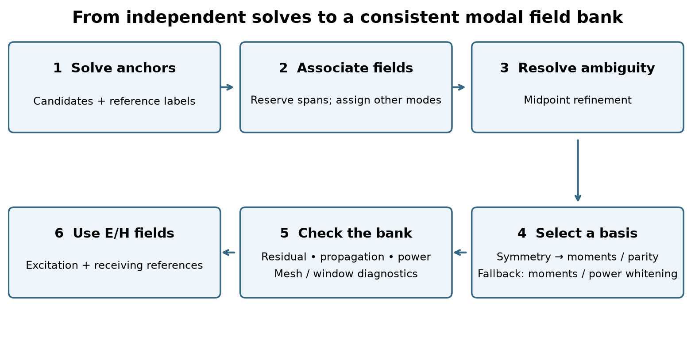
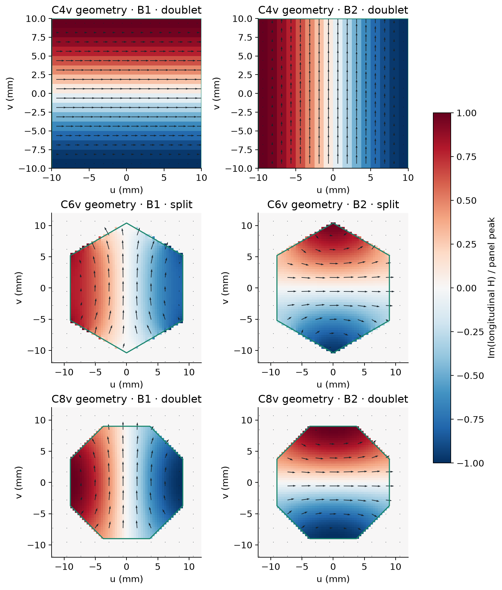
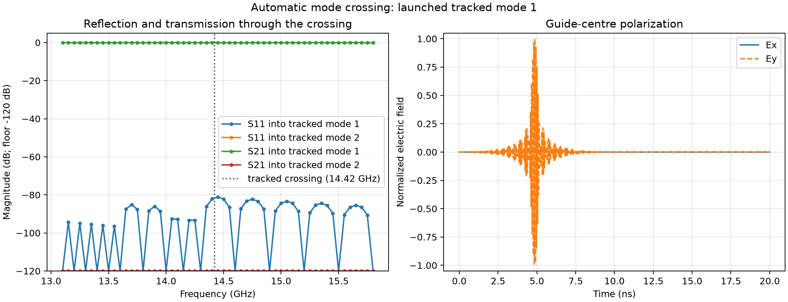

.. _eigenmode-tracking:
.. _eigenmode-mode-tracking:

************************
Eigenmode tracking guide
************************

Mode tracking connects independently solved port fields into a consistent
broadband field bank. It follows branches through crossings, aligns phase,
and selects reproducible bases for degenerate groups. This guide covers the
inputs, workflow, automatic symmetry selection, and inspection of the resulting fields.
For aperture setup and S-parameter measurement, see :doc:`eigenmode_port`;
for equations and implementation details, see :doc:`eigenmode_tracking_theory`.

.. contents:: On this page
   :local:
   :depth: 2

Enabling tracking and choosing what to inspect
==============================================

Add ``tracking="auto"`` to each participating source and receiver port.
This also enables symmetry detection and basis selection for eligible
degenerate groups on supported 3D port cross sections. Explicit
``mode_polarizations`` takes precedence when selecting a pair's directions.
Start with the default ``verification="full"`` when evaluating a model.
``verification="fast"`` skips the extra mesh and window solves, so it provides
less evidence about box modes. Examples 8 and 9 use ``fast`` to keep their
inspection runs short; change it to ``full`` to perform those extra checks.

.. code-block:: python

   scene.add(gprMax.EigenmodePort(
       port=1, p1=(0.02, 0.005, 0), p2=(0.02, 0.075, float("inf")),
       direction="+", modes=(1, 2), anchors="auto",
       tracking="auto", verification="full", plot_fields=True,
   ))

``anchors="auto"`` and ``tracking="auto"`` do different jobs: **anchors choose
where to solve; tracking chooses which solutions to connect**. You can also
provide an explicit list of anchor frequencies, as Examples 8 and 9 do.

Mode labels are assigned at the anchor nearest the band center (the lower
frequency on a tie), then followed toward both ends of the band. Thus
``mode=1`` means a tracked channel, not necessarily the first raw solution at
every frequency. When comparing with an older run, check the actual fields
at both ports rather than assuming that the same number means the same
polarization.

Run Examples 8 and 9 with ``--geometry-only`` to inspect their dispersion
curves and modal fields before the time-domain simulation. Their scripts set
``plot_fields=True``, so a full run also produces these plots. At a crossing,
check that the labels follow consistent fields. For TE11, check that the chosen
polarizations stay aligned. For an open guide, check the outer-edge fields and
any confinement warnings. Read the warning status as well as the curve: a
smooth curve can still describe a questionable profile.

Tracking does not guarantee low S11. Correctly matched fields can still be
interpolated too coarsely, especially near cutoff. Check convergence with
closer anchor spacing, a suitable aperture, mesh resolution, PML thickness,
and recording duration when small reflections matter.

Tracking input arguments
========================

Pass these arguments to ``gprMax.EigenmodePort``. The aperture, propagation
direction, and port identifier are configured as in :doc:`eigenmode_port`.
The first table covers channel selection and basis construction; the next
table lists every ``EigenmodeTrackingConfig`` control.

.. list-table:: Port arguments used by tracking
   :header-rows: 1
   :widths: 23 18 59
   :class: api-parameters

   * - Argument
     - Default
     - Use
   * - ``modes``
     - Required
     - Public channel indices, or a positive integer count. With automatic tracking these labels refer to the anchor nearest the band center, then follow the matched fields. Internal partners do not add public channels.
   * - ``anchors``
     - ``"auto"``
     - Frequencies in Hz at which to solve the port. Accepts a positive frequency, an increasing sequence, or automatic selection. Tracking may add midpoint solves to resolve ambiguous associations.
   * - ``tracking``
     - ``"legacy"``
     - ``"auto"`` enables field assignment, group detection, automatic symmetry selection, and adaptive refinement. ``"legacy"`` retains ordering and manual grouping and skips symmetry selection. Automatic tracking is experimental.
   * - ``verification``
     - ``"full"``
     - With automatic tracking, ``"full"`` adds finer-grid and open-window comparisons; ``"fast"`` checks residuals and edge fields without those extra solves.
   * - ``tracking_config``
     - ``None``
     - An ``EigenmodeTrackingConfig`` instance or mapping overriding the numerical controls in the next table. Omitted fields keep their defaults.
   * - ``mode_polarizations``
     - ``None``
     - Optional transverse direction(s) for electric-moment alignment of a pair: an axis name, a real three-vector, or two directions. One direction defines its partner by the positive port-normal axis crossed with it. Shared directions work with automatic tracking; mappings to exact mode indices require legacy tracking. Overrides automatic symmetry selection.
   * - ``degenerate``
     - ``None``
     - Legacy groups such as ``(1, 2)`` or ``((1, 2), (3, 4))``. Members must be requested in ``modes``. Automatic tracking detects groups and ignores this argument.
   * - ``plot_fields``
     - ``None``
     - ``True`` writes dispersion and modal-field plots in all runs; ``False`` suppresses them; ``None`` writes them in geometry-only runs.

Symmetry detection and basis selection run automatically with ``tracking="auto"``
on supported 3D port cross sections. Legacy tracking skips symmetry selection.
Polarization vectors use the Python API. Keep the same basis convention
at both ports when comparing their channel coefficients.

Advanced thresholds and limits
------------------------------

Most users can leave these settings at their defaults. Inspect the fields and
geometry before relaxing a threshold to suppress a warning. Pass
``tracking_config=gprMax.EigenmodeTrackingConfig(...)`` or a mapping to
override the defaults below. Omitted fields keep their defaults. All thresholds
are dimensionless; integer controls count candidates, refinement steps, or
additional solves. These controls apply only to automatic tracking.
Thresholds must be finite and in ``(0, 1]``; ``extra_candidates`` and
``max_depth`` are nonnegative integers, and ``max_solves`` is a positive integer.

.. list-table:: EigenmodeTrackingConfig
   :class: api-parameters
   :header-rows: 1
   :widths: 25 15 60

   * - Parameter
     - Default
     - Meaning
   * - ``residual_tolerance``
     - ``1e-7``
     - Common maximum relative residual for input eigenpairs, mixed reduced vectors, and available reconstructed-field checks. Eigenvalue-gap, propagation, and power checks also apply.
   * - ``beta_drift_tolerance``
     - ``1e-3``
     - Maximum normalized propagation-constant drift in mesh/window verification.
   * - ``verification_overlap``
     - ``0.999``
     - Minimum squared field overlap, or smallest squared principal subspace overlap, in verification comparisons.
   * - ``edge_fraction_max``
     - ``1e-3``
     - Maximum fraction of the squared E/H field norm in the outer edge strip (10% of each transverse extent, at least one cell) used as confinement evidence at artificial boundaries.
   * - ``tracking_overlap``
     - ``0.8``
     - Minimum squared field/subspace overlap for a candidate match. This is distinct from the stricter verification overlap.
   * - ``assignment_margin``
     - ``0.02``
     - Minimum total-cost advantage over an alternative one-to-one assignment for an individual-mode match.
   * - ``subspace_margin``
     - ``0.02``
     - Minimum separation of the squared projection scores of the last selected and first excluded members when extracting a subgroup from a larger cluster.
   * - ``unmatched_cost``
     - ``0.65``
     - Cost of leaving an individual mode unmatched rather than forcing a poor match.
   * - ``cluster_gap``
     - ``1e-5``
     - Relative eigenvalue gap for candidate clusters. It does not relax the stricter ``1e-8`` degeneracy condition for mixing fields.
   * - ``extra_candidates``
     - ``4``
     - Additional internal eigenpairs requested per solve, subject to solver size, to find competing branches or missing partners.
   * - ``max_depth``
     - ``8``
     - Maximum adaptive midpoint-refinement steps for resolving identity ambiguity; ``0`` disables these extra frequency solves.
   * - ``min_relative_step``
     - ``1e-5``
     - Stop refining an ambiguous interval when its width divided by its midpoint frequency reaches this threshold.
   * - ``max_solves``
     - ``200``
     - Budget for additional adaptive and verification solves per port. Required primary anchors are retained independently of this budget.

For example, allow more internal candidates while retaining all other defaults:

.. code-block:: python

   tracking_config = gprMax.EigenmodeTrackingConfig(extra_candidates=6)
   # Pass tracking="auto", tracking_config=tracking_config to EigenmodePort.

The equivalent hash options use the field names directly, without a
``tracking_config`` prefix:

.. code-block:: none

   #eigenmode_port: 1 0.02 0.005 0 0.02 0.075 inf + 1,2 auto y tracking=auto verification=full extra_candidates=6

How automatic tracking works
============================

An **anchor** is a frequency at which the port eigenproblem is solved. A
**candidate** is one of that solve's eigenmodes. A **branch** is the sequence
of fields associated across anchors. A **degenerate group** contains independent
fields with the same propagation constant; its individual eigenvectors can
rotate while their combined span stays unchanged.

   Association establishes continuity; basis selection supplies reproducible
   E/H fields for interpolation. Extra candidates and midpoint solves help
   resolve ambiguous matches.

1. **Solve and seed labels.** Solve the primary anchors with extra internal
   candidates. Assign public labels at the anchor nearest the band center,
   and work outward toward lower and higher frequencies.
2. **Associate fields.** For isolated modes, combine E/H overlap and eigenvalue
   prediction in a global one-to-one assignment. Degenerate candidates are
   recognized and reserved by span matching before this individual assignment.
   When a group encounters another branch or group, projection and continuity
   tests identify the persistent subgroups inside the enlarged cluster.
3. **Refine ambiguous intervals.** Insert midpoint anchors when overlap or
   assignment margins cannot resolve a match. Refinement stops at the configured
   depth, frequency spacing, or solve budget; unresolved intervals retain their
   diagnostic status.
4. **Construct a reproducible basis.** Align each isolated mode's common E/H
   phase. For a persistent degenerate group, **field mixing** means applying
   the same linear combination to all E and H components. Verify the discrete
   symmetry, separate longitudinal-field families, and resolve irreducible
   subspaces. Electric moments or mirror parity orient each doublet;
   directional field variation separates compatible equal-parity singlets.
   The fallback uses usable
   electric moments for a pair, otherwise a power-whitened basis for the full
   group. No waveguide preset or mode-index template is required.
5. **Check and use the bank.** Record identity, residual, propagation, power,
   and boundary diagnostics separately. Eligible propagating fields supply
   excitation. Receiving references can also describe evanescent fields, with
   finite normalization and valid coefficient decomposition.

Power whitening transforms the group's full real-power matrix to the identity.
Consequently a coefficient vector has power equal to its squared norm, and
unitary changes of basis preserve that power. It supplies a stable numerical
basis when a physical orientation cannot be determined.

After physical families are separated, whitening is applied within each
retained block. Cross-block power terms are retained: the complete bank's
power is evaluated with its full Hermitian power matrix.

The candidate-cluster gap and the mixing tolerance serve different purposes.
``cluster_gap`` searches for nearby branches; the stricter eigenvalue-spread
and residual checks decide whether their fields may be combined. Increasing
``cluster_gap`` alone does not enable approximate mixing of split modes.

Why track modes?
================

A broadband pulse contains many frequencies. To launch the intended mode
across that band, the port needs to know what its field looks like at each
frequency. It solves the fields at a set of frequencies called **anchors**,
then interpolates between them.

That interpolation only makes sense if the anchor fields belong together.
Blending an x-polarized mode at one frequency with an unrelated y-polarized
mode at the next creates the wrong broadband source, even if both individual
mode solves are accurate. It can also make the receiving port measure the
wrong channel. **Mode tracking decides which fields belong to the same mode
as frequency changes.** Its verification checks also warn about profiles that
may be distorted by the finite port aperture.

When mode numbers swap: a crossing in an anisotropic guide
----------------------------------------------------------

An anisotropic dielectric can affect x- and y-polarized fields differently.
Their propagation constants can therefore cross as frequency changes, as in
:ref:`eigenmode-example-9`. The fields remain distinguishable, but their order
in the solver's list changes. For example:

.. list-table:: Why the raw solution number is not a reliable mode identity
   :class: api-parameters
   :header-rows: 1

   * - Frequency
     - First solution in the sorted list
     - Second solution in the sorted list
   * - Below a crossing
     - Mostly x-polarized
     - Mostly y-polarized
   * - Above the crossing
     - Mostly y-polarized
     - Mostly x-polarized

If the source simply took the first solution at every anchor, its polarization
would switch at the crossing. Interpolating those fields would blend two
different channels. A receiver using the same mistaken numbering could then
report an apparent change in transmission or coupling between modes.

Automatic tracking compares the **field patterns**, as well as how their
propagation constants change. In this example it connects the x-like field
below the crossing to the x-like field above it, even when its raw solution
number changes. The selected channel follows one curve *through* the crossing
instead of jumping to the other curve. Distinct modes retain their own
propagation constants; tracking does not average them together.

In the plots, follow one label across neighbouring frequencies: its field
should change consistently. A crossing in the dispersion plot is not itself
an error. At an avoided crossing, the physical fields can gradually exchange
character; tracking is not a rule that forces every mode to stay x-polarized
or y-polarized forever.

When polarization rotates arbitrarily: the circular TE11 pair
-------------------------------------------------------------

A circular waveguide has two TE11 modes with the same propagation constant.
One can be chosen x-polarized and the other y-polarized. Because they are
**degenerate** (they share that propagation constant), rotated combinations
are equally valid solutions.

An eigensolver might return x/y fields at one anchor and two diagonal fields
at the next. Nothing in the circular guide has rotated: the solver has simply
chosen different representatives of the same pair. Interpolating the first
returned field at each frequency would make the source polarization vary
across the pulse's band. Measured coupling into the other polarization could
then reflect this choice of fields rather than a physical effect.

Automatic tracking recognizes the pair and aligns it **as a pair**. In
:ref:`eigenmode-example-8`, it chooses x/y directions consistently at the
anchors, so a selected input polarization keeps its meaning across the band.
The pair does not need to be declared with ``degenerate``, and
``mode_polarizations`` is optional. Supply ``"y"`` when you want y/-x
directions instead of x/y, and use the same choice at both ports.

Even if you request only ``modes=(1,)``, the tracker can solve the second member
internally to align the pair. That extra solve does not add another public
input or output channel. Alignment is only allowed when the modes really can
be mixed without breaking their field equations. Two nearby modes with
different, resolved propagation constants stay separate.

When the mode belongs to the artificial box
-------------------------------------------

An open guide, such as a coplanar waveguide, has fields extending into the
surrounding air. The mode solver can only see the finite cross-section inside
the port aperture. Its artificial outer boundary can influence the fields
or support a pattern that mainly belongs to that calculation box. This is a
**box mode**; it is not the same as a legitimate mode confined by the physical
metal walls of a waveguide.

A box mode can be solved very accurately and still be a poor representation
of the intended guide. If used for injection or measurement, it can produce
results that depend strongly on the chosen aperture. Following that pattern
consistently across frequency would not, by itself, make it a good profile.

With ``verification="full"``, automatic tracking asks practical questions:

* Is much of the field still present near the artificial outer boundary?
* If the window is enlarged using the surrounding model geometry, does the
  field pattern or propagation constant change appreciably?
* Does a finer transverse grid give a consistent result?

These checks can flag a **suspected** box mode or poorly confined profile.
Mesh sensitivity alone does not prove that a mode is a box artifact. Nor can
the checks always distinguish an artificial mode from a real guided mode
whose field has simply been cut off by a small aperture.

For example, a low-frequency CPW mode can have a wide field extending far into
the air. A small aperture may truncate it and trigger a warning, even though
it is the intended mode. **A confinement or box-mode warning does not remove
the profile:** it remains available if its numerical solution, tracking, and
forward power are valid. The warning says that accuracy may be reduced.
Enlarge the aperture, leave enough surrounding non-PML geometry for the
checks, and compare the fields and S-parameters. Tracking helps identify the
problem; it cannot supply the missing space around the guide.

Degeneracy and polarization choices
===================================

.. _eigenmode-degeneracy-explained:

What degeneracy means for a port
--------------------------------

Two modes are **degenerate** when they have the same propagation constant
at a given frequency but independent field patterns. They accumulate the
same propagation phase along a uniform guide. This does not mean that they
are duplicate results or that only one should be kept: they represent two
independent channels that the guide can carry.

The circular TE11 pair is a familiar example. An ideal circular guide has
no preferred transverse direction. One TE11 pattern can be oriented with
its overall electric polarization along y and another along x. Rotated
combinations, such as two diagonal polarizations, describe the same pair
equally well. The chosen pair of patterns is called a **basis**. Changing
the basis changes how we label and combine the channels, not the guide.

Why mode numbers alone can be misleading
^^^^^^^^^^^^^^^^^^^^^^^^^^^^^^^^^^^^^^^^

An eigensolver finds valid field patterns, but symmetry does not tell it
which one to call vertical. At one frequency it might return vertical and
horizontal patterns as modes 1 and 2; at another it might return the same
patterns in reverse order, or two diagonal combinations. Small numerical
differences can change that choice even when the physical guide is unchanged.
This is a change of basis, not evidence that the guide has converted the
wave's polarization.

Broadband ports solve several frequency anchors and interpolate their
fields. If mode 1 means vertical at one anchor and diagonal at the next,
interpolating those raw patterns would change the intended polarization
across the pulse spectrum. Tracking the complete degenerate pair lets
gprMax compare the same two-channel space before choosing its labels.

Which option should I use?
^^^^^^^^^^^^^^^^^^^^^^^^^^

* Use ``degenerate=(1, 2)`` when you want the pair tracked together but do
  not need mode numbers to mean particular physical directions with legacy
  tracking. Its initial basis is arbitrary; subsequent anchors follow it smoothly.
* Also use ``mode_polarizations="y"`` when you want mode 1
  to mean vertical and mode 2 horizontal for a z-directed guide. gprMax
  enforces those physical directions independently at each retained anchor.
  Use the same assignments at the receiving port to measure the same labels.
* Use ``tracking="auto"`` to detect groups and select their bases through
  symmetry, electric moments, and mirror parity. The fundamental circular
  pair selects transverse directions as in :ref:`eigenmode-example-8`.
  ``degenerate`` is ignored in this mode; ``mode_polarizations`` remains useful
  for rotating or swapping the default directions.

Declaring the pair neither excites both channels nor forces their physical
propagation constants to become equal. ``EigenmodeExcitation`` still selects
the channel to launch. A declared pair contributes two channels to a complete
S-matrix study, so each needs its own independent excitation case.

Near equality alone is not enough to justify mixing. For example, an
elliptical guide can split the circular pair into modes with different
propagation constants. Those modes accumulate different phases, and a
combination can change polarization as it travels. That is physical beating,
which should be represented using independent modes. gprMax accepts exact
or numerically unresolved degeneracy for mixing. It rejects resolved splitting
in a declared group and keeps split automatic branches separate; the
thresholds and alignment method are in :ref:`eigenmode-degenerate-theory`.

Physically labeled degenerate modes
-----------------------------------

The default ``mode_polarizations=None`` uses automatic basis selection.
For a pair with independent integrated electric moments, request particular
directions using one of these
three forms. Use the same choice at the source and receiving ports.

1. **One direction for every pair.** Set ``mode_polarizations="y"`` (or
   ``"x"``/``"z"``). The first member of each pair follows that direction;
   the second follows the positive port-normal axis crossed with the first.
   For a z-normal port, ``"y"`` gives y/-x. A real three-vector such as
   ``mode_polarizations=(1, 1, 0)`` selects a diagonal direction and infers
   its orthogonal partner. This form works with automatic or legacy tracking.

2. **Two directions for every pair.** Set ``mode_polarizations=("y", "x")``
   to explicitly select both members: first y, second x. For diagonal
   directions use ``mode_polarizations=((1, 1, 0), (-1, 1, 0))``. Axes and
   vectors can be mixed, for example ``("x", (1, 1, 0))``. The directions
   must be linearly independent; they need not be orthogonal and are not
   automatically orthogonalized. This form also works with either tracker.

3. **Exact mode assignments, legacy tracking only.** Set
   ``tracking="legacy"``, declare ``degenerate=((1, 2), (3, 4))``, and use
   ``mode_polarizations={1: "y", 2: "x", 3: "x", 4: "y"}`` to give different
   pairs different directions. Mapping keys are absolute mode indices:
   ``{1: "y", 2: "x"}`` affects only modes 1 and 2. Supply both members of
   each pair you select; other declared pairs retain their existing assignment.
   All declared members must be included in ``modes``. Mappings are rejected
   with ``tracking="auto"``; replace them with form 1 or 2, or explicitly
   switch to legacy tracking and declare the pairs.

For shared forms, first and second mean the lower and higher tracked mode
indices within each detected or declared pair, not raw eigensolver ordering.
They apply to every pair, including a partner solved internally by automatic
tracking. Isolated modes are unchanged. Alignment requires a genuine
numerically degenerate two-mode subspace; it does not force split modes to
become degenerate. A shared override with no eligible pair is an error.

All axes are global and must be transverse to the port normal: ``"z"`` is
invalid for a z-normal port. Vectors must be finite, nonzero and real, and are
normalized. A normalized normal component larger than ``1e-12`` is rejected
(roundoff below that tolerance is removed). For two directions, gprMax rejects
a normalized direction matrix condition number above ``10``. The angle between
the directions must therefore be approximately 11.4 to 168.6 degrees; directions
too close to parallel or antiparallel are rejected before solving. These errors
also apply to explicit legacy mappings. Choose two well-separated transverse
directions, ideally orthogonal. gprMax does not repair an invalid pair by
projecting it into the transverse plane or orthogonalizing it.

The sign convention is independent of propagation direction.
Thus ``"y"`` and ``("y", "x")`` differ in the second member's sign for a
z-normal port. An explicitly requested direction that the subspace cannot
represent raises an error rather than silently falling back.

For circular TE11 propagating along z, assign the channels once:

.. code-block:: python

   scene.add(gprMax.EigenmodePort(
       port=1, p1=(0, 0, 0.02), p2=(0.05, 0.05, 0.02), direction="+",
       modes=(1, 2), anchors="auto", tracking="auto",
       mode_polarizations="y",  # Or ("y", "x") to explicitly choose both.
   ))
   scene.add(gprMax.EigenmodeExcitation(port=1, mode=1, waveform="auto"))

Here mode 1 is vertically polarized (global y); changing only ``mode=1`` to
``mode=2`` launches horizontal polarization (global -x). Reversing propagation
does not change these electric-field labels. ``anchors="auto"`` selects the
frequency anchors; it does not enable automatic mode tracking. Set
``tracking="auto"`` explicitly to discover pairs without ``degenerate``.

Equivalent hash options follow the existing anchor and plotting arguments:

.. code-block:: none

   ## One direction for every detected pair:
   #eigenmode_port: 1 0 0 0.02 0.05 0.05 0.02 + 1,2 auto tracking=auto mode_polarizations=y
   ## Two explicit directions for every detected pair:
   #eigenmode_port: 1 0 0 0.02 0.05 0.05 0.02 + 1,2 auto tracking=auto mode_polarizations=y;x
   ## Exact mode indices, with declared legacy pairs:
   #eigenmode_port: 1 0 0 0.02 0.05 0.05 0.02 + 1,2 auto tracking=legacy degenerate=1,2 mode_polarizations=1:y;2:x

These are alternatives: use one definition per port. Components inside a
vector use commas, and two directions use a semicolon:
``mode_polarizations=1,1,0;-1,1,0``. Mapping entries use a colon between mode
index and direction. Do not put spaces inside hash option values. Omitting
the option corresponds to Python ``None``. Values are parsed literally,
with no expression evaluation.

Polarization describes the direction of the transverse electric field
integrated across the aperture; local arrows need not all be parallel. gprMax
aligns that direction at every retained frequency anchor. Geometry-only plots,
single-anchor and broadband sources, monitors, studies, and virtual guides
all use the same aligned fields. Set ``plot_fields=True`` to also write the
standard modal pictures during a full run. Example 7 shows the two tracked
TE11 profiles.

With only ``degenerate``, the group is tracked smoothly, but its orientations
at the reference anchor remain arbitrary. With neither argument, modes keep
the existing independent tracking. Physical axis/vector selection requires
a two-mode group in a 3D cross-section. With one direction, the second is inferred.

Declare a group only for exact or numerically unresolved degeneracy. If
asymmetry resolves the splitting, excite the independently solved modes or
correct unintended geometry asymmetry. A group with negligible integrated
electric field cannot be oriented by axis/vector references; use generic
group tracking. These failures and their numerical thresholds are derived
in :ref:`eigenmode-degenerate-theory`.

.. _tracking-symmetry-options:

Automatic symmetry detection
----------------------------

With ``tracking="auto"``, no symmetry label is required. ``EigenmodePort`` detects C4v or
C2v from the discretized port at every solved anchor and uses the strongest
group common to the bank. C4v requires a square mesh with equal spacing;
C2v requires the two grid-axis mirrors and also applies to rectangular meshes.
The tests compare complex diagonal material tensors and PEC/PMC masks about
the port-window center (relative tolerance ``1e-10``, absolute ``1e-12``).
Resolved eigenvalues remain separate tracking branches.

Native rotations and reflections act on the complete staggered E/H fields.
Their modal representations must preserve each eligible span and its power
metric, and satisfy the group relations before decomposition. Centered
circular and octagonal interfaces can preserve C4v after staircasing; a
hexagonal interface can retain C2v. C4v produces singlets or E doublets;
C2v produces singlets. C2v labels use the port normal as the twofold axis,
with B1 u-like and B2 v-like under the two mirrors.
The algorithm supports any group dimension: repeated C4v doublets can produce
``2+2+2`` from a six-dimensional span or ten doublets from a twenty-dimensional
span. One-dimensional representations remain single channels. Frequency
continuation aligns the resulting blocks across the active anchor range.

Repeated copies of the same symmetry can contain different field families.
The code first compares longitudinal electric and magnetic content through
a small generalized eigenproblem. In a uniform metallic guide this separates
TE and TM copies. In a dielectric guide it supplies a field-based family
selection when the longitudinal scores are distinct. Singular or unresolved
scores retain the existing symmetry decomposition.

Within each native doublet, the code first tries to align the integrated
transverse electric moments with the u and v axes. It uses a unitary polar
factor to preserve whitened power, accepting moments with relative strength
above ``1e-12``, condition number below ``1e8``, and the expected vector
mirror parities. If this test fails, diagonalizing the u-mirror selects its
odd and even partners, in that order. The v-mirror supplies an independent
parity check. Reflections act on E as a polar vector and H as an axial vector.
These parity labels describe the complete E/H field, not each component
separately, and do not assign conventional TE/TM or numerical mode indices.

Reference phases are deterministic; a quarter turn relates zero-moment
doublet partners. Subsequent anchors transport individual phases without
mixing opposite parities. Each anchor records the orientation method,
moment strength, vector parities, parity residual, and individual channel
overlaps under ``symmetry_subspaces/.../anchor.../orientation``.

Equal-parity singlets can still represent rotated partners. Within one
eligible longitudinal family, the axis-sensitive step compares variation
along u and v and selects combinations with distinct directional scores.
For example, it converts the square-guide combinations TE20 +/- TE02 into
individual TE20 and TE02 fields. The same operation accepts hybrid E/H
fields. Unresolved directional scores retain the established basis.

Axis selection can combine different rotation irreps. Each anchor therefore
stores the original ``irreducible_basis`` separately from the final source
``transform``. ``axis_sensitive`` records the selected blocks and scores;
``longitudinal`` records family selection. A source-block symmetry label such
as ``A2+B2`` describes the irreps contributing to that source field.

Each group is tested independently. If C4v decomposition fails, C2v is tried
when supported; if neither succeeds, a two-mode group retains its electric-
moment basis when the moments define independent axes throughout the active
bank. Otherwise it retains the power-whitened basis at its full dimension.
Two transverse electric moments cannot fully orient a group larger than two.
Trials check span closure, continuity, mixed eigen-residuals,
reconstructed Maxwell residuals when available, positive full-group power,
and unit power within each retained block before
publishing any fields. SIBC ports additionally certify retained electric and
magnetic samples, complex boundary permittivities, and signed circulation
coefficients per retained dual area. Symmetric copper walls can therefore
use the same decomposition and axis selection; uncertified boundaries and
unsupported transverse solvers use the fallback. HDF5 ``symmetry_detection`` records detected
symmetries at each anchor, the applied choice per group, and rejected-trial
reasons; ``symmetry_subspaces`` stores successful decompositions.

Before accepting a selected basis, the complete power-wave measurement bank
must pass the modal coefficient solver's precision budget for both electric
and magnetic Gram matrices, including coupling to modes outside the selected
group. Single precision allows a condition number of about ``8.4e3``;
double precision allows ``1e10``. The separate positive-power and symmetry
checks also apply. A rejected trial tries the next certified symmetry and
then retains the fallback basis if needed. Inspect the rejected-trial reasons
in ``symmetry_detection`` when the selected basis differs between precisions.

Neighboring fields continue the selected families and orientations across
frequency. The original tracking group remains available in
``degenerate_groups``; the selected source subspaces and their transformations
are stored in ``symmetry_subspaces`` in the HDF5 output.

Explicit ``mode_polarizations`` takes priority over automatic symmetry selection.

.. _tracking-hybrid-conventions:

TE/TM and HE/EH conventions
---------------------------

TE modes have zero longitudinal electric field, :math:`E_w=0`; TM modes have
zero longitudinal magnetic field, :math:`H_w=0`. Dielectric guides generally
support **hybrid modes**, with both components nonzero. We use **HE** and
**EH** for the conventional hybrid families. Their identification follows
the vector fields and dispersion of a reference waveguide; the numerical
longitudinal-content score alone does not assign an HE/EH name.

In an ideal circular dielectric guide, :math:`\mathrm{HE}_{mn}` and
:math:`\mathrm{EH}_{mn}` use azimuthal order m and radial order n. The
fundamental pair is :math:`\mathrm{HE}_{11}`. Sine/cosine angular partners
belong to the same family and share the same indices. For rectangular or
square dielectric cores, an HE-like or EH-like label refers to a stated
reference-field convention; the circular angular/radial indices do not
directly become transverse m/n indices. See the
`COMSOL vector hybrid-mode example <https://doc.comsol.com/6.4/doc/com.comsol.help.models.woptics.microstructured_optical_fiber/microstructured_optical_fiber.html>`_
and its HE/EH field comparisons.

The runtime retains stable branch labels B1, B2, and so on. These labels
identify computed channels through frequency sweeps. Field plots may add a
verified conventional name, while parity and symmetry labels describe the
computed orientation.

Validated axis and hybrid-field examples
----------------------------------------

The square PEC validation uses 48 x 48 and 64 x 64 meshes, 40--44 GHz, and
34 tracked modes (32 requested plus two internal partners). All 34 modes
match individual analytical longitudinal patterns after axis selection,
including TE20/TE02, TE13/TE31, TM13/TM31, and TM24/TM42. Analytical templates
are used only to check the output fields.

.. figure:: ../../images_shared/mode_tracking_axis_partners.png
   :width: 100%
   :alt: Individually oriented TE and TM mn/nm partners in a square metallic guide.

   Axis-sensitive selection recovers the remaining square-guide partners.
   Panels show normalized longitudinal fields at 42 GHz on the 64 x 64 mesh.

The dielectric tests use relative permittivity 4 cores in air: a 20 x 14 mm
rectangle, a 20 x 20 mm square, and a 10 mm radius cylinder. Twelve channels
are tracked over nine anchors from 18 to 22 GHz on 64 x 64 and 96 x 96
meshes. A 40 mm square PEC truncation window is compared with a 60 mm window
at unchanged spacing. The rectangular guide has twelve distinct branches;
the square and circular cases have four doublets and four singlets.
All nine banks pass residual, power, parity, and continuity checks.
The largest effective-index change from enlarging the window is
:math:`2.26\times10^{-5}`. These ordinary single-core examples already have
resolved symmetry orientations, so the additional axis step is inactive.

.. figure:: ../../images_shared/mode_tracking_dielectric_hybrid_fields.png
   :width: 100%
   :alt: Longitudinal electric and magnetic components of higher-order dielectric hybrid modes.

   HE/EH hybrid-field examples at 20 GHz on 96 x 96 meshes. Both longitudinal
   components are shown; branch labels avoid assigning unverified HE/EH
   indices. Display phases and amplitude scales are chosen independently
   for each component. Dashed outlines show the dielectric cores.

.. figure:: ../../images_shared/mode_tracking_dielectric_branches.png
   :width: 100%
   :alt: Tracked branches and doublets in rectangular, square, and circular dielectric cores.

   Frequency continuity of the twelve dielectric channels. A doublet is
   represented by its mean effective index and its two branch labels.

A separate Maxwell control uses four PEC-separated chambers containing
rotated dielectric cores. It creates three exact four-dimensional hybrid
groups and exercises axis selection in 27 group/anchor cases. Changing the
raw solver bases reproduces the oriented fields with overlap above
0.9999999999999; the maximum reconstructed-field residual is
:math:`1.08\times10^{-13}`. This control tests repeated hybrid copies, while
the single-core studies above test the familiar dielectric geometries.

Reproducible numerical sources are
``testing/validation/longitudinal_mode_identification.py``,
``testing/validation/dielectric_mode_separation.py``, and
``testing/validation/axis_hybrid_control.py``. Figure provenance is recorded
in ``images_shared/mode_tracking_figures.json``.

Warnings and inspection
-----------------------

A warning about the aperture is different from a failed mode solve or an
uncertain mode identity. Use the following distinction when deciding what to
change:

.. list-table:: What the result means for your source
   :class: api-parameters
   :header-rows: 1
   :widths: 30 35 35

   * - Result
     - What happens
     - What to inspect
   * - Suspected box mode or poor confinement
     - A numerically valid, confidently tracked mode with forward power
       stays in use, with an accuracy warning. This warning alone does not
       remove anchors or change mode numbers.
     - Check whether the field reaches the artificial edge. Enlarge the
       aperture and compare fields and S-parameters.
   * - Verification could not finish
     - The result is unresolved, rather than proved good or bad. A usable
       primary profile is retained.
     - Read the reason: surrounding geometry may be unavailable, refinement
       may be unsupported, or the extra-solve budget may be exhausted.
   * - Unsure which mode connects to the next anchor
     - The tracker tries more candidates and intermediate frequencies. If
       still unresolved, it uses the automatic-anchor fallback or raises an
       error for explicit anchors. It does not interpolate across the gap.
     - Inspect the fields on both sides of the uncertain interval and the
       anchor-selection message before trusting the broadband result.
   * - Failed numerical solution
     - Fields that fail the equation checks, contain nonfinite values, or
       cannot be reconstructed or aligned reliably cannot supply a profile.
     - Investigate the solve failure; enlarging a warning threshold does not
       repair unusable fields.

A mode below cutoff is another case: decay along the guide does not make it
a box mode. It may remain useful as a receiver reference, but a mode without
usable forward power cannot be injected as a travelling power wave.

The figures place the dispersion curves, ``Re(n_eff)`` and ``-Im(n_eff)``,
above the E/H fields. The first shows how the phase propagation changes with
frequency; the second shows attenuation for the passive forward convention.
Diagnostic markers distinguish questionable profiles that remain in use
from missing or unusable profiles. A nonzero attenuation curve alone is not
evidence of a box mode.

For detailed inspection, the HDF5 ``mode_tracking`` group records which
solutions were matched, equation errors, verification evidence, and unresolved
intervals. Existing anchor and power validity masks keep their meanings.
The equations and exact decision rules are in
:ref:`eigenmode-auto-tracking-theory`.

.. _tracking-symmetry-examples:

Illustrated symmetry and crossing tests
=======================================

The following plots use saved FDFD validation banks. They illustrate the
sampled eigenmodes and their tracking; the time-domain input examples follow
in the next section. Figure provenance, including source-data hashes, is
recorded in ``images_shared/mode_tracking_figures.json``.

Square, hexagonal, and octagonal guides
---------------------------------------

On a square transverse Yee grid, the strongest native planar rotation/mirror
group is C4v: quarter turns and mirrors map staggered samples onto samples.
The 60-degree rotations of C6v and 45-degree rotations of C8v need off-grid
samples. The sampled material can therefore retain a smaller group than its
smooth boundary. See :ref:`tracking-symmetry-theory` for the lattice argument.

   Paired fields at 20 GHz. Rows show a C4v square guide, a C6v hexagonal
   boundary whose grid retains C2v, and a C8v octagonal boundary whose grid
   retains C4v. Color is the signed longitudinal magnetic field, normalized
   separately in each panel; arrows show transverse E with the same display
   phase. The hexagonal pair is split; the displayed square and octagonal
   pairs remain degenerate. Color shows :math:`\operatorname{Im}(H_w)` and
   arrows :math:`\operatorname{Re}(\mathbf E_t)`, which are
   in quadrature for these lossless TE-like fields. B labels denote tracked
   channels, not irreps.

The square example uses a 20-mm aperture, 16 cells per side, and relative
permittivity 2. The polygon examples use a 9-mm apothem, a 24-mm window,
relative permittivity 2, and PEC material outside the polygon. Their finest
grid has 64 cells per side (0.375 mm). At 20 GHz, the leading hexagonal pair
has :math:`|\Delta n_{\rm eff}|=0.006693`; the leading octagonal pair differs
by less than :math:`10^{-12}`. A higher octagonal pair splits by 0.008126.
Thus the same sampled octagon supports both a protected doublet and resolved
singlets.

.. figure:: ../../images_shared/mode_tracking_polygon_splitting.png
   :width: 100%
   :alt: Pair splitting versus grid spacing and tracked effective indices versus frequency for hexagonal and octagonal guides.

   Mesh study at 20 GHz (top) and tracked branches on the finest grid
   (bottom). Refinement changes the staircase and its splitting; the gaps
   need not decrease monotonically. Overlapping B1/B2 curves in the octagon
   are a retained doublet. Resolved B4/B5 branches remain separate.

Higher-order and crossing doublets
----------------------------------

Higher-order square-guide fields can have zero integrated electric moment.
Mirror parity still gives a reproducible orientation of each native doublet,
as illustrated in :ref:`tracking-symmetry-theory`. This selection requires
neither a TE/TM declaration nor a requested polarization direction.

For a separate crossing test, a 20-mm-square, 64-by-64-cell PEC guide is
loaded with a symmetric, spatially varying diagonal dielectric at 20 GHz.
In normalized coordinates :math:`u,v\in[-1,1]`, set

.. math::

   p=\cos(\pi u)+\cos(\pi v)+0.35\cos(\pi u)\cos(\pi v),
   \qquad \epsilon_u=\epsilon_v=2+tp,\qquad
   \epsilon_w=2+t(1.1+0.7p).

Sweeping :math:`t` from -0.12 to 0.12 makes two hybrid-mode doublets meet at
:math:`t=0`. The test applies a complex rotation to the coincident four-mode
solver basis. Tracking retains two continuous subspaces through that crossing;
the smallest squared adjacent subspace overlap is 0.999812. The basis orientation
uses electric moments away from the crossing and mirror parity where those
moments vanish.

.. figure:: ../../images_shared/mode_tracking_hybrid_crossing.png
   :width: 100%
   :alt: Effective indices and continuity diagnostics for crossing hybrid-mode doublets.

   Two tracked hybrid doublets through a four-mode coincidence. The parameter
   changes the dielectric while frequency stays fixed at 20 GHz. The curves
   and diagnostics are from the saved crossing validation, not a new FDTD run.

.. figure:: ../../images_shared/mode_tracking_hybrid_fields.png
   :width: 100%
   :alt: Longitudinal electric amplitudes and transverse electric vectors before, at, and after a doublet crossing.

   Fields at :math:`t=-0.12,0,+0.12`. Full-vector mirror parities preserve
   the partner ordering as the orientation changes from electric moments to
   mirror parity and back. Color shows longitudinal electric amplitude;
   arrows show the transverse electric field on the 64 x 64 mesh.

The validation sources are ``testing/validation/polygon_symmetry_breaking.py``
and ``testing/validation/longitudinal_mode_identification.py``. Geometry and run
manifests remain with those data.

Worked input models
===================

.. _eigenmode-example-8:

Example 8: automatic circular TE11 degeneracy
---------------------------------------------

This 3D straight circular PEC guide has two ports and measures both TE11
polarizations over 20--24 GHz. Both ports use ``tracking="auto"`` and omit
``degenerate`` and ``mode_polarizations``. The tracker discovers the pair and
defaults mode 1 to global x and mode 2 to global y. These labels differ from
Example 7's explicit y/-x assignment. One or two shared polarization
directions can swap or rotate them. Requesting only ``modes=(1,)`` still solves the missing
partner internally without adding a second public channel.

The bore retains ``averaging="y"`` as explained in
:ref:`eigenmode-pec-wall-sampling`. Explicit anchors resolve the modal impedance
between 20 and 24 GHz and cover the pulse's spectral guards; grouping and
polarization remain automatic. A virtual guide terminates the source port,
and the receiving end continues into the domain PML.

:download:`Complete Python model <../../examples/features/eigenmode_ports/example_8_auto_degenerate_te11/auto_degenerate_te11.py>`
and :download:`result plotter <../../examples/features/eigenmode_ports/example_8_auto_degenerate_te11/plot_results.py>`

.. code-block:: console

   python examples/features/eigenmode_ports/example_8_auto_degenerate_te11/auto_degenerate_te11.py --geometry-only
   python examples/features/eigenmode_ports/example_8_auto_degenerate_te11/auto_degenerate_te11.py --mode 1
   python examples/features/eigenmode_ports/example_8_auto_degenerate_te11/plot_results.py --mode 1
   python examples/features/eigenmode_ports/example_8_auto_degenerate_te11/auto_degenerate_te11.py --mode 2
   python examples/features/eigenmode_ports/example_8_auto_degenerate_te11/plot_results.py --mode 2

The model sets ``plot_fields=True``, so both geometry-only and full runs write
``auto_degenerate_te11_modeN_PortP_ModeM.png`` for each port and tracked mode.
Each figure combines dispersion curves with the modal E/H fields at retained
anchors. The two branches should have coincident effective indices and
consistent orthogonal polarizations. After each full run, the plotter writes
``auto_degenerate_te11_modeN_results.png`` showing co- and cross-polarized
S11/S21 and the center receiver's Ex/Ey traces.

.. figure:: ../../images_shared/auto_degenerate_te11_mode1_results.png
   :alt: Automatically tracked circular TE11 mode 1 with co-polarized transmission and a guide-center Ex pulse, while the orthogonal channel remains small.
   :width: 100%

   Example 8, launched mode 1: the detected pair retains its global x/y
   polarization labels across the band; the plotted output is dominated by
   the driven x-polarized channel.

This example uses
``verification="fast"`` for quick inspection; omitting that argument selects
the automatic tracker's default full verification. Fast diagnostics do not
include mesh or larger-window comparison solves. In the tested
double-precision CPU configuration, the worst co-polarized S11 is about
-62.9 dB for either excitation and co-polarized S21 is near 0 dB.

.. _eigenmode-example-9:

Example 9: a mode crossing in an anisotropic guide
--------------------------------------------------

This 3D example uses one straight rectangular PEC guide with a 16 by 8 mm
bore filled by the diagonal relative-permittivity tensor
``diag(2.25, 1, 1)``. Its two polarized fundamental branches have different
cutoff terms and slopes. Their effective-index curves cross near 14.4 GHz
on this voxel grid. Both ports use ``tracking="auto"``: each public label
should retain its polarization while its raw eigensolver order changes.
The distinct propagation constants are preserved on either side of the
crossing; the two branches are not treated as a permanently degenerate pair.

The ports are separated by 52 mm and measure 13.1--15.8 GHz. The anisotropic
fill is built before the surrounding PEC walls to preserve their electric
boundary samples. Explicit anchors are closer near the lower band's cutoff,
where the modal impedance changes rapidly. Both guide ends continue through
16-cell domain PMLs.

:download:`Complete Python model <../../examples/features/eigenmode_ports/example_9_auto_mode_crossing/auto_mode_crossing.py>`
and :download:`result plotter <../../examples/features/eigenmode_ports/example_9_auto_mode_crossing/plot_results.py>`

.. code-block:: console

   python examples/features/eigenmode_ports/example_9_auto_mode_crossing/auto_mode_crossing.py --geometry-only
   python examples/features/eigenmode_ports/example_9_auto_mode_crossing/auto_mode_crossing.py --mode 1
   python examples/features/eigenmode_ports/example_9_auto_mode_crossing/plot_results.py --mode 1
   python examples/features/eigenmode_ports/example_9_auto_mode_crossing/auto_mode_crossing.py --mode 2
   python examples/features/eigenmode_ports/example_9_auto_mode_crossing/plot_results.py --mode 2

Both ports set ``plot_fields=True``. Inspect
``auto_mode_crossing_modeN_PortP_ModeM.png`` for the crossing dispersion curves
and the tracked E/H polarization at each anchor. The geometry-only command
produces these figures without time stepping. After a full run,
``auto_mode_crossing_modeN_results.png`` shows both modes' S11/S21, marks the
crossing frequency, and plots the guide-center polarization.

   Example 9, launched tracked mode 1: the response remains on one
   polarization branch through the crossing near 14.42 GHz.

This example selects
``verification="fast"``. Use ``verification="full"`` to request the extra
verification solves. Tested double-precision CPU runs give worst co-polarized
S11 of about -81.1 dB for mode 1 and -62.4 dB for mode 2, with co-polarized S21
near 0 dB. These values describe the supplied voxel model and sampled band;
tracking confidence alone does not guarantee that reflection accuracy for
other anchor spacings, meshes, or terminations.

.. _tracked-mode-gallery:

Example 10: sixteen-mode inspection gallery
-------------------------------------------

The :download:`mode gallery <../../examples/features/eigenmode_ports/example_10_tracked_mode_gallery/tracked_modes.py>`
tracks 16 channels in rectangular, square, and circular PEC waveguides and
in dielectric rods with the same cross-sections. It uses automatic tracking
and symmetry selection with five anchors from 40 to 42 GHz. Degenerate groups
can retain additional internal partners beyond the 16 displayed channels.

.. code-block:: console

   python examples/features/eigenmode_ports/example_10_tracked_mode_gallery/tracked_modes.py

The run uses ``geometry_only=True`` with no excitation or virtual guide.
The :download:`plotter <../../examples/features/eigenmode_ports/example_10_tracked_mode_gallery/plot_results.py>`
shows all 16 electric and magnetic profiles at 41 GHz and both real and
imaginary effective-index curves. ``--profiles`` adds per-channel plots at
every anchor; ``--verification full`` enables additional verification solves.
Use a fresh ``--output`` directory when changing settings.

The lossless dielectric cores have relative permittivity 4 and sit in air
inside a finite modal aperture with a PEC rim. Check aperture and mesh
convergence when comparing with isolated-rod modes. Full dimensions and
output descriptions are in the :download:`example README
<../../examples/features/eigenmode_ports/example_10_tracked_mode_gallery/README.rst>`.
