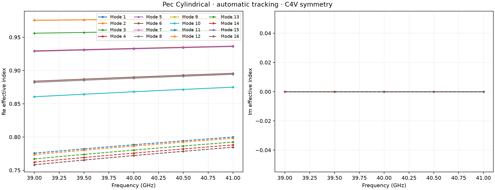
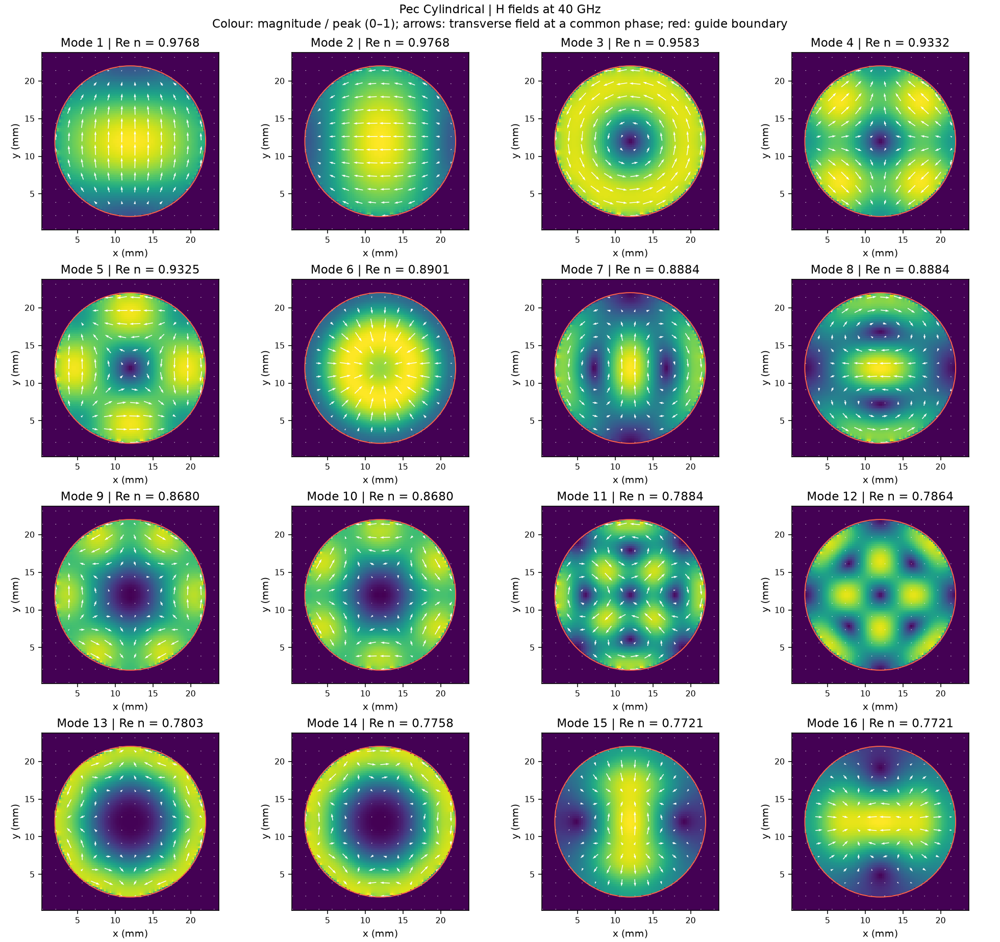

Example 3: PEC cylindrical tracked modes
========================================

Run from the repository root::

   python examples/features/eigenmode_tracking/example_3/tracked_modes.py

The script performs a geometry-only run, tracks at least sixteen modes, and
writes native E/H fields, electric and magnetic galleries, and real/imaginary
propagation curves. It automatically detects C4v on the square Yee mesh. No excitation
or time stepping is used. The default spacing is 0.25 mm. Use ``--spacing-mm``
for mesh refinement, ``--modes`` for the requested channel count, or
``--output`` for a fresh result directory. Internal partners can complete a
persistent degenerate group.

The bore is vacuum-filled and bounded by PEC walls.

Recorded geometry-only gallery
------------------------------

.. figure:: ../../examples/features/eigenmode_tracking/example_3/gallery/pec_cylindrical_E_modes.png
   :width: 100%
   :alt: Electric fields for every tracked channel.

:download:`Executable script <../../examples/features/eigenmode_tracking/example_3/tracked_modes.py>`

:download:`Recorded run metadata <../../examples/features/eigenmode_tracking/example_3/gallery/manifest.json>`
