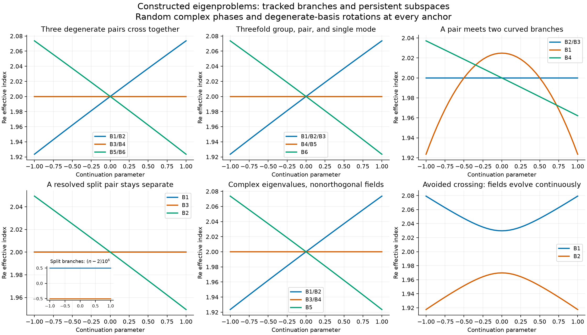
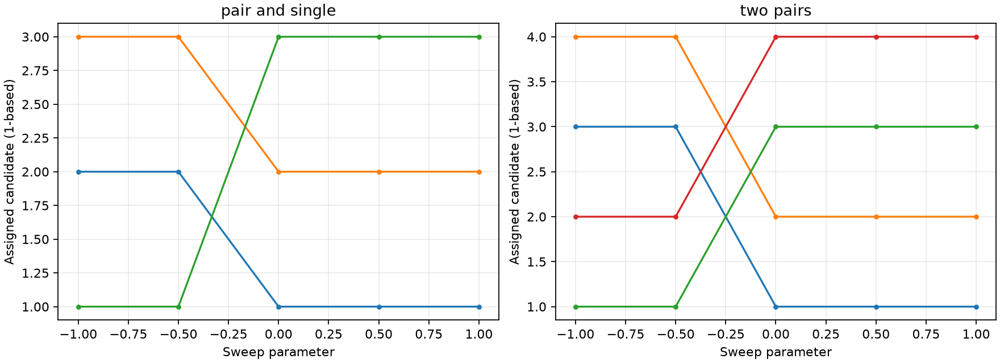
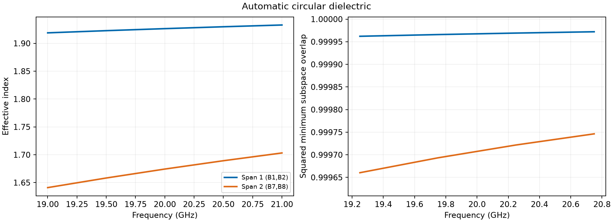
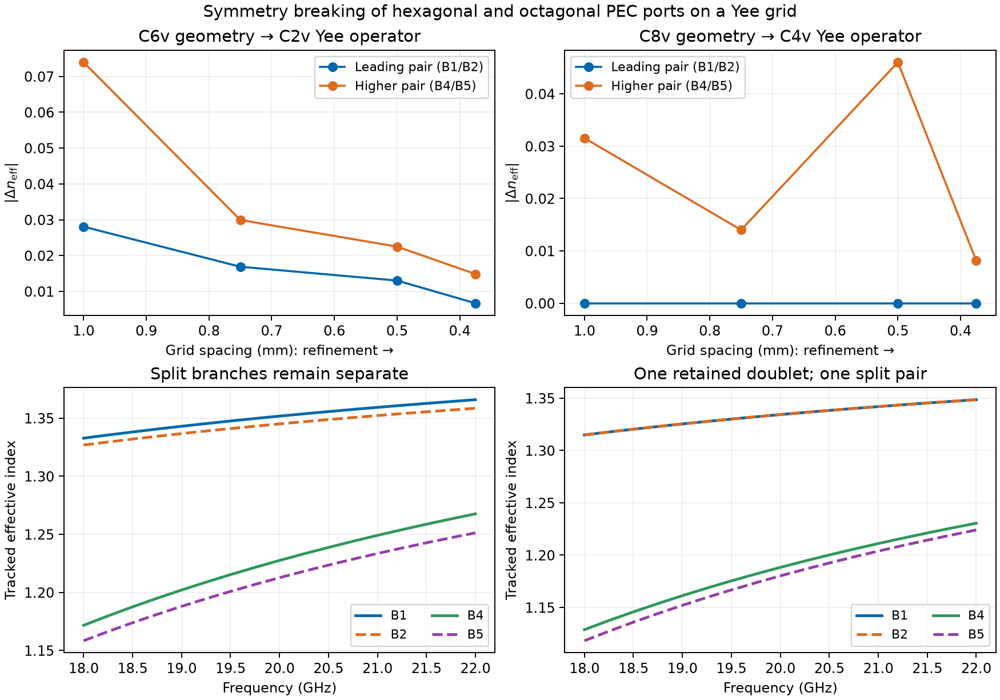
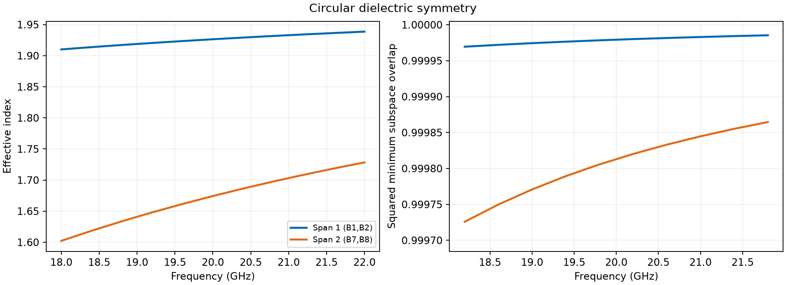
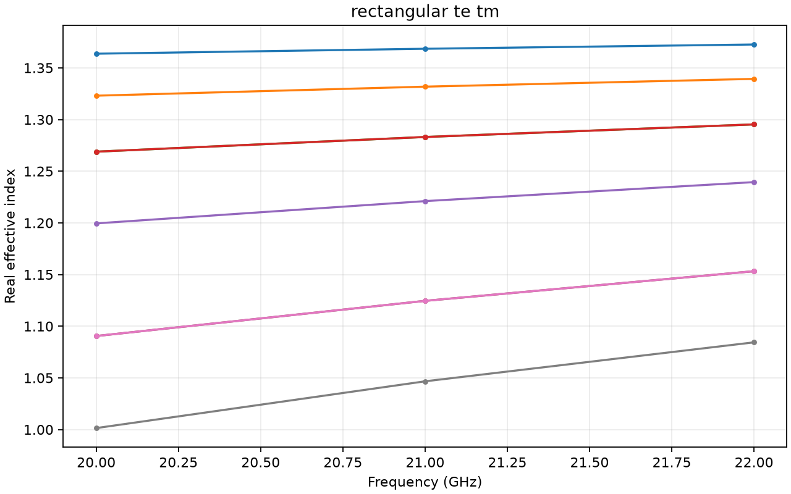
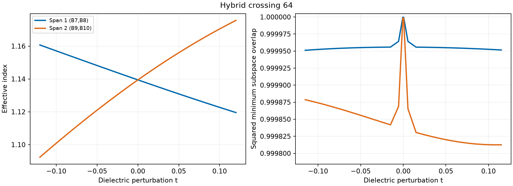
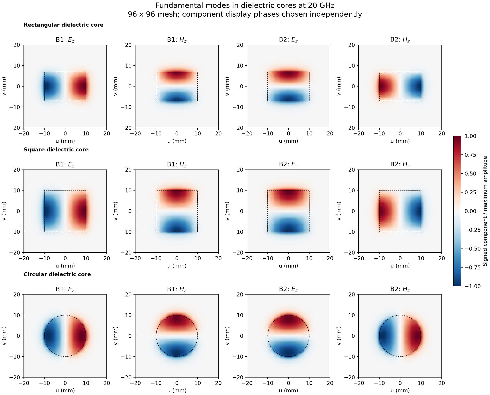
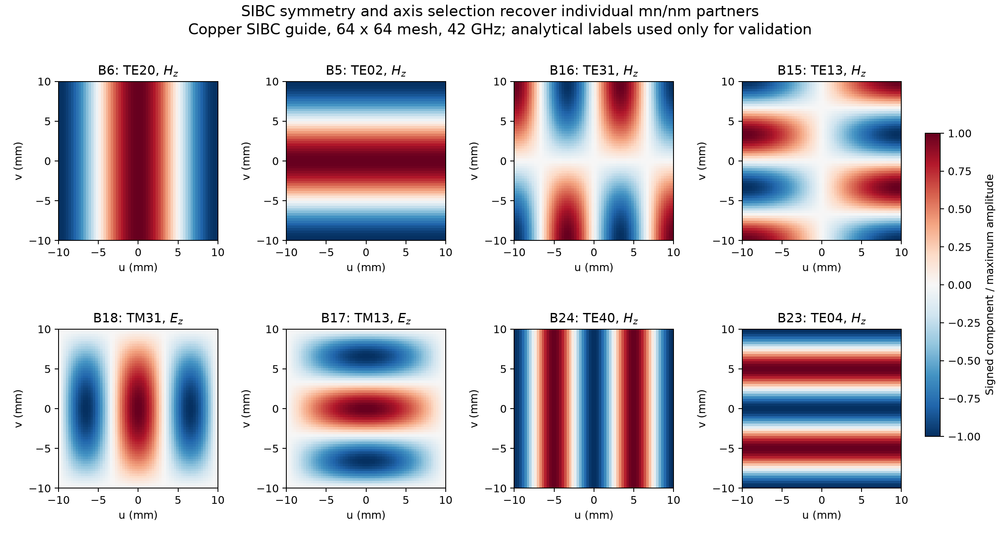

.. _eigenmode_tracking_validation_catalog:

Eigenmode tracking validation gallery
=====================================

The validation studies live under ``testing/validation/eigenmode_tracking/``.
The categories below cover the earlier tracking studies and the analytical
modal-profile comparisons. Each linked study index includes its full plot
gallery and reports. Historical run metadata and hashes remain unchanged;
only persistent, expanded, and classification results were rerun during this
reorganization. The other plots show retained runs, not a new execution of
the current solver. NPZ field archives are local run products.

See :doc:`waveguide_modal_validation` and :doc:`cylindrical_modal_validation`
for analytical field matching, mesh convergence, and copper attenuation.

subspaces: expanded
-------------------

:download:`Full gallery and reports <../../testing/validation/eigenmode_tracking/subspaces/results/expanded/README.rst>`

   Subspaces: expanded. The full gallery includes all retained case plots.

subspaces: general
------------------

:download:`Full gallery and reports <../../testing/validation/eigenmode_tracking/subspaces/results/general/README.rst>`

.. figure:: ../../testing/validation/eigenmode_tracking/subspaces/results/general/c4v_dielectric_hybrid_tracking.png
   :width: 95%
   :alt: subspaces: general

   Subspaces: general. The full gallery includes all retained case plots.

subspaces: persistent
---------------------

:download:`Full gallery and reports <../../testing/validation/eigenmode_tracking/subspaces/results/persistent/README.rst>`

   Subspaces: persistent. The full gallery includes all retained case plots.

symmetry: automatic
-------------------

:download:`Full gallery and reports <../../testing/validation/eigenmode_tracking/symmetry/results/automatic/README.rst>`

   Symmetry: automatic. The full gallery includes all retained case plots.

symmetry: fine mesh
-------------------

:download:`Full gallery and reports <../../testing/validation/eigenmode_tracking/symmetry/results/fine_mesh/README.rst>`

   Symmetry: fine mesh. The full gallery includes all retained case plots.

symmetry: moment parity
-----------------------

:download:`Full gallery and reports <../../testing/validation/eigenmode_tracking/symmetry/results/moment_parity/README.rst>`

.. figure:: ../../testing/validation/eigenmode_tracking/symmetry/results/moment_parity/circular_higher_order_partners_tracking.png
   :width: 95%
   :alt: symmetry: moment parity

   Symmetry: moment parity. The full gallery includes all retained case plots.

symmetry: polygons
------------------

:download:`Full gallery and reports <../../testing/validation/eigenmode_tracking/symmetry/results/polygons/README.rst>`

   Symmetry: polygons. The full gallery includes all retained case plots.

symmetry: waveguides
--------------------

:download:`Full gallery and reports <../../testing/validation/eigenmode_tracking/symmetry/results/waveguides/README.rst>`

   Symmetry: waveguides. The full gallery includes all retained case plots.

identification: C2v TE TM
-------------------------

:download:`Full gallery and reports <../../testing/validation/eigenmode_tracking/identification/results/C2v_TE_TM/README.rst>`

   Identification: c2v te tm. The full gallery includes all retained case plots.

identification: classification
------------------------------

:download:`Full gallery and reports <../../testing/validation/eigenmode_tracking/identification/results/classification/README.rst>`

.. figure:: ../../testing/validation/eigenmode_tracking/identification/results/classification/circular_32_tracks.png
   :width: 95%
   :alt: identification: classification

   Identification: classification. The full gallery includes all retained case plots.

identification: higher circular
-------------------------------

:download:`Full gallery and reports <../../testing/validation/eigenmode_tracking/identification/results/higher_circular/README.rst>`

.. figure:: ../../testing/validation/eigenmode_tracking/identification/results/higher_circular/voxel_circular_higher_64_tracks.png
   :width: 95%
   :alt: identification: higher circular

   Identification: higher circular. The full gallery includes all retained case plots.

identification: longitudinal
----------------------------

:download:`Full gallery and reports <../../testing/validation/eigenmode_tracking/identification/results/longitudinal/README.rst>`

   Identification: longitudinal. The full gallery includes all retained case plots.

dielectric: hybrid control
--------------------------

:download:`Full gallery and reports <../../testing/validation/eigenmode_tracking/dielectric/results/hybrid_control/README.rst>`

.. figure:: ../../testing/validation/eigenmode_tracking/dielectric/results/hybrid_control/hybrid_four_chamber_tracks.png
   :width: 95%
   :alt: dielectric: hybrid control

   Dielectric: hybrid control. The full gallery includes all retained case plots.

dielectric: separation
----------------------

:download:`Full gallery and reports <../../testing/validation/eigenmode_tracking/dielectric/results/separation/README.rst>`

   Dielectric: separation. The full gallery includes all retained case plots.

conductors: copper symmetry
---------------------------

:download:`Full gallery and reports <../../testing/validation/eigenmode_tracking/conductors/results/copper_symmetry/README.rst>`

   Conductors: copper symmetry. The full gallery includes all retained case plots.

profiles: C2v rectangle 2to1 copper
-----------------------------------

:download:`Full gallery and reports <../../testing/validation/eigenmode_tracking/profiles/results/C2v_rectangle_2to1_copper/README.rst>`

.. figure:: ../../testing/validation/eigenmode_tracking/profiles/results/C2v_rectangle_2to1_copper/C2v_rectangle_2to1_copper_attenuation.png
   :width: 95%
   :alt: profiles: C2v rectangle 2to1 copper

   Profiles: c2v rectangle 2to1 copper. The full gallery includes all retained case plots.

profiles: C2v rectangle 2to1 PEC
--------------------------------

:download:`Full gallery and reports <../../testing/validation/eigenmode_tracking/profiles/results/C2v_rectangle_2to1_PEC/README.rst>`

.. figure:: ../../testing/validation/eigenmode_tracking/profiles/results/C2v_rectangle_2to1_PEC/C2v_rectangle_2to1_PEC_matching.png
   :width: 95%
   :alt: profiles: C2v rectangle 2to1 PEC

   Profiles: c2v rectangle 2to1 pec. The full gallery includes all retained case plots.

profiles: C4v cylindrical copper
--------------------------------

:download:`Full gallery and reports <../../testing/validation/eigenmode_tracking/profiles/results/C4v_cylindrical_copper/README.rst>`

.. figure:: ../../testing/validation/eigenmode_tracking/profiles/results/C4v_cylindrical_copper/C4v_cylindrical_copper_attenuation.png
   :width: 95%
   :alt: profiles: C4v cylindrical copper

   Profiles: c4v cylindrical copper. The full gallery includes all retained case plots.

profiles: C4v cylindrical PEC
-----------------------------

:download:`Full gallery and reports <../../testing/validation/eigenmode_tracking/profiles/results/C4v_cylindrical_PEC/README.rst>`

.. figure:: ../../testing/validation/eigenmode_tracking/profiles/results/C4v_cylindrical_PEC/C4v_cylindrical_PEC_convergence.png
   :width: 95%
   :alt: profiles: C4v cylindrical PEC

   Profiles: c4v cylindrical pec. The full gallery includes all retained case plots.

profiles: C4v square copper
---------------------------

:download:`Full gallery and reports <../../testing/validation/eigenmode_tracking/profiles/results/C4v_square_copper/README.rst>`

.. figure:: ../../testing/validation/eigenmode_tracking/profiles/results/C4v_square_copper/C4v_square_copper_attenuation.png
   :width: 95%
   :alt: profiles: C4v square copper

   Profiles: c4v square copper. The full gallery includes all retained case plots.

profiles: C4v square PEC
------------------------

:download:`Full gallery and reports <../../testing/validation/eigenmode_tracking/profiles/results/C4v_square_PEC/README.rst>`

.. figure:: ../../testing/validation/eigenmode_tracking/profiles/results/C4v_square_PEC/C4v_square_PEC_matching.png
   :width: 95%
   :alt: profiles: C4v square PEC

   Profiles: c4v square pec. The full gallery includes all retained case plots.

ports: figures
--------------

:download:`Full gallery and reports <../../testing/validation/eigenmode_tracking/ports/figures/README.rst>`

.. figure:: ../../testing/validation/eigenmode_tracking/ports/figures/auto_degenerate_te11_mode1_results.png
   :width: 95%
   :alt: ports: figures

   Ports: figures. The full gallery includes all retained case plots.

overview: figures
-----------------

:download:`Full gallery and reports <../../testing/validation/eigenmode_tracking/overview/figures/README.rst>`

.. figure:: ../../testing/validation/eigenmode_tracking/overview/figures/mode_tracking_lattice_rotations.png
   :width: 95%
   :alt: overview: figures

   Overview: figures. The full gallery includes all retained case plots.
