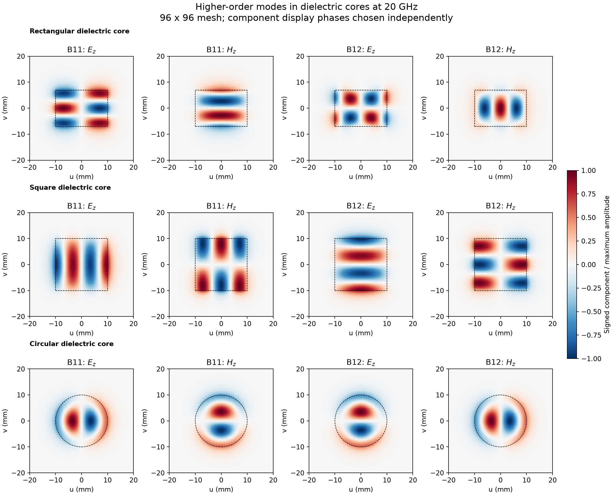
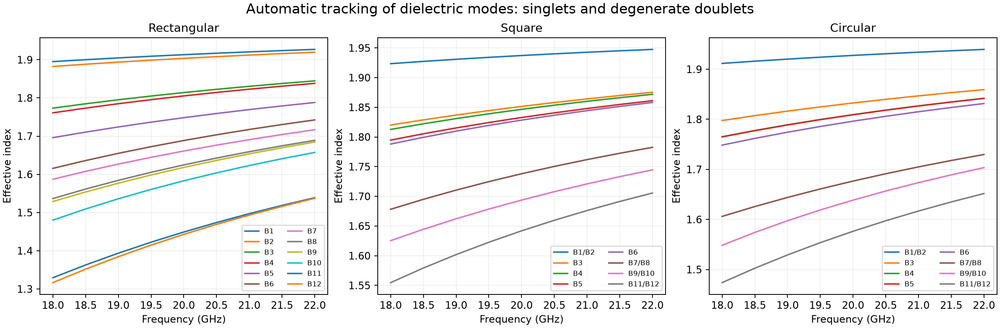

dielectric: separation
======================

* `circular_64_40mm.json <circular_64_40mm.json>`_
* `circular_96_40mm.json <circular_96_40mm.json>`_
* `circular_96_60mm.json <circular_96_60mm.json>`_
* `manifest.json <manifest.json>`_
* `rectangular_64_40mm.json <rectangular_64_40mm.json>`_
* `rectangular_96_40mm.json <rectangular_96_40mm.json>`_
* `rectangular_96_60mm.json <rectangular_96_60mm.json>`_
* `square_64_40mm.json <square_64_40mm.json>`_
* `square_96_40mm.json <square_96_40mm.json>`_
* `square_96_60mm.json <square_96_60mm.json>`_
* `window_comparison.json <window_comparison.json>`_

.. image:: fundamental_fields.png
   :alt: fundamental fields
   :width: 100%

