identification: classification
==============================

* `circular_32.json <circular_32.json>`_
* `circular_48.json <circular_48.json>`_
* `copper_square_24.json <copper_square_24.json>`_
* `copper_square_24_raw.json <copper_square_24_raw.json>`_
* `copper_square_32.json <copper_square_32.json>`_
* `copper_square_32_raw.json <copper_square_32_raw.json>`_
* `manifest.json <manifest.json>`_
* `square_axial_anisotropy.json <square_axial_anisotropy.json>`_
* `square_isotropic.json <square_isotropic.json>`_
* `square_transverse_anisotropy.json <square_transverse_anisotropy.json>`_
* `summary.json <summary.json>`_

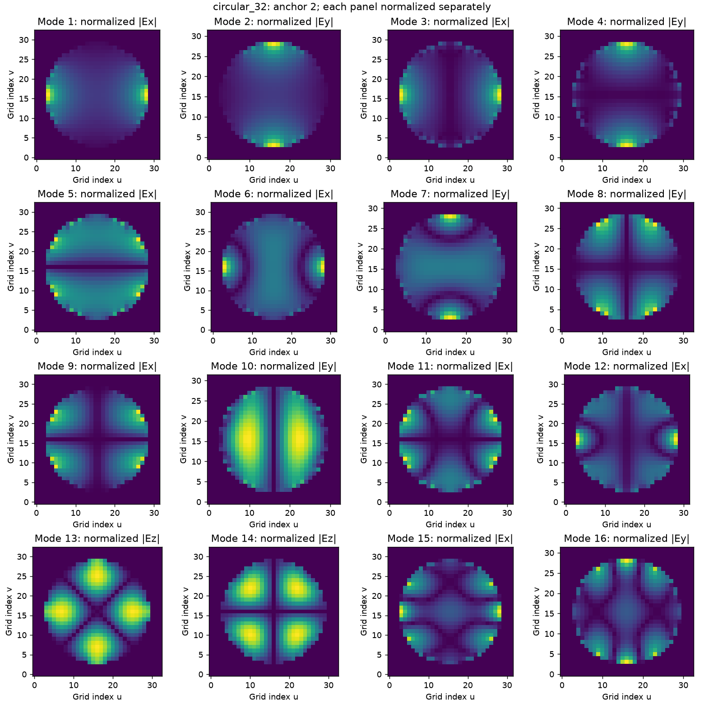

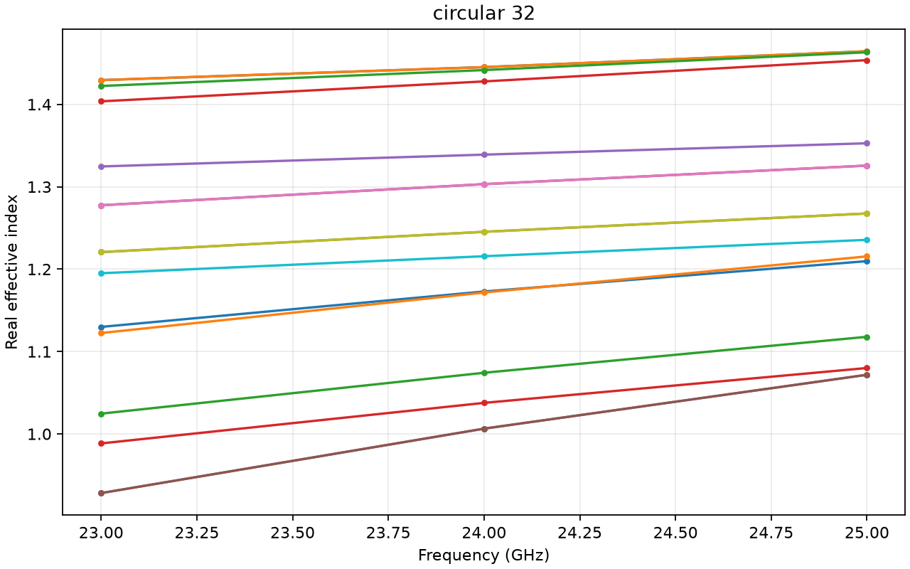

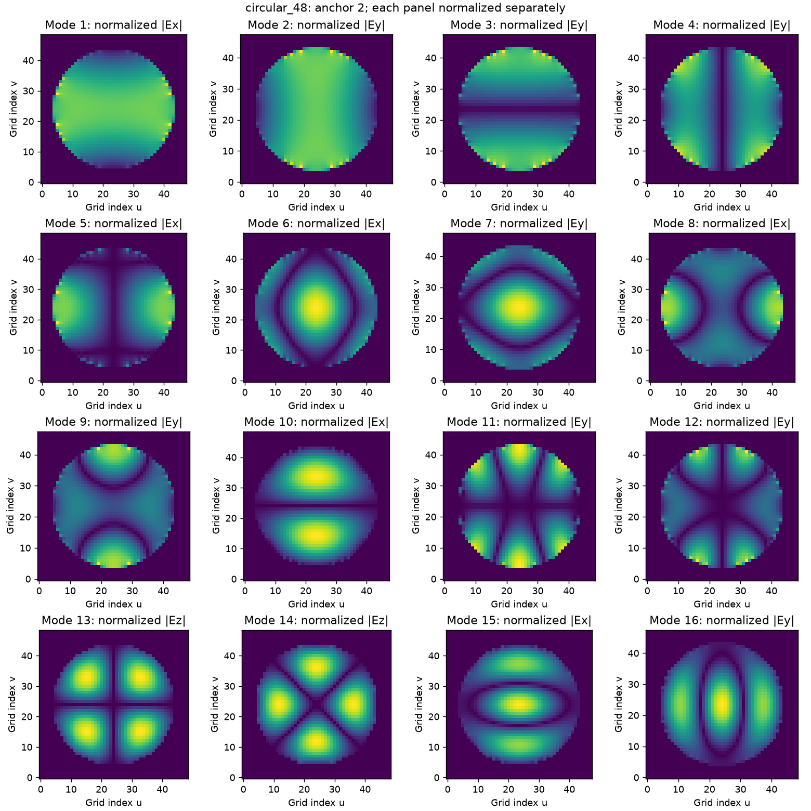

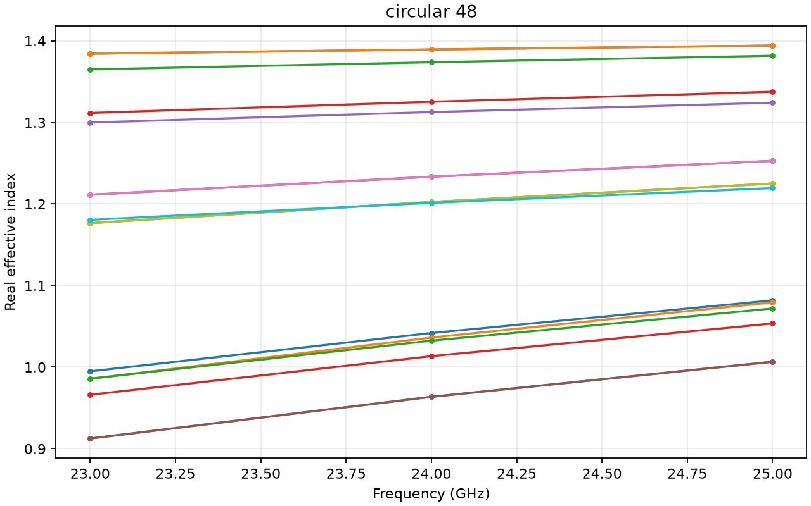

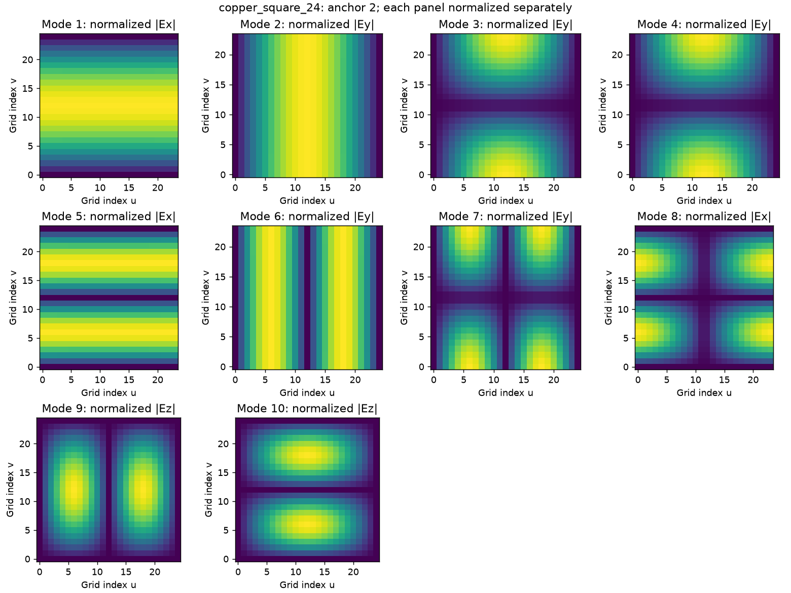

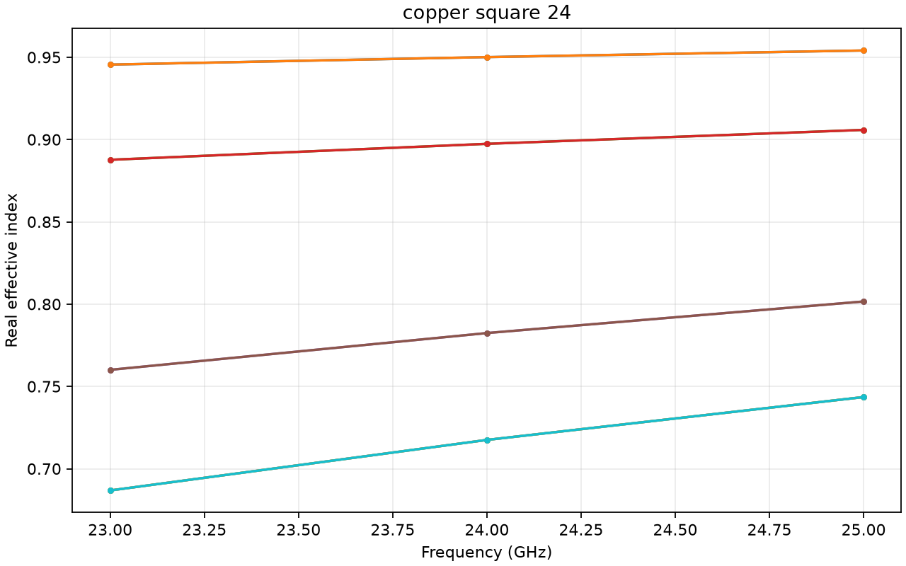

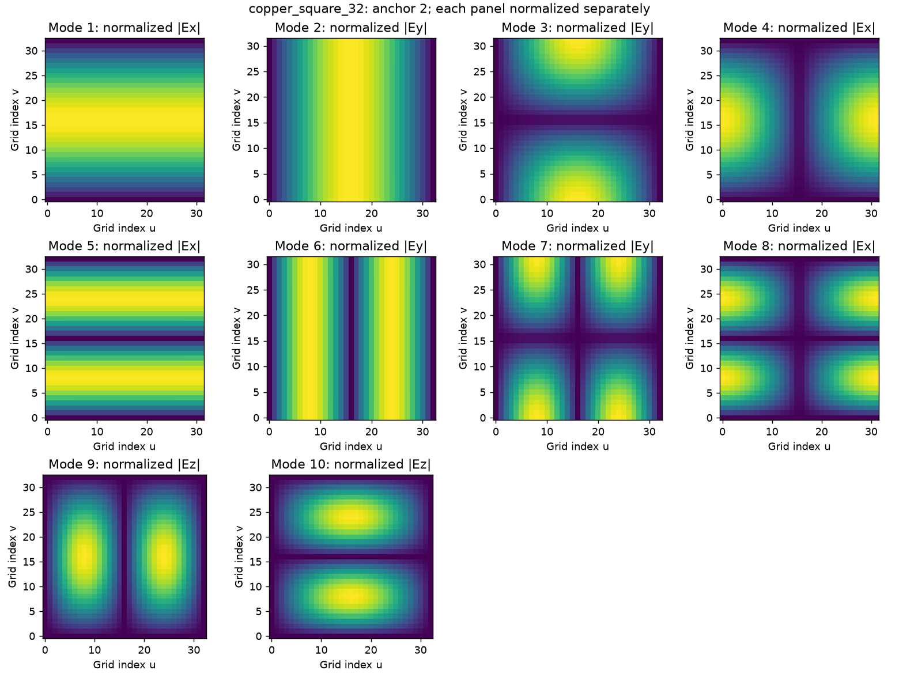

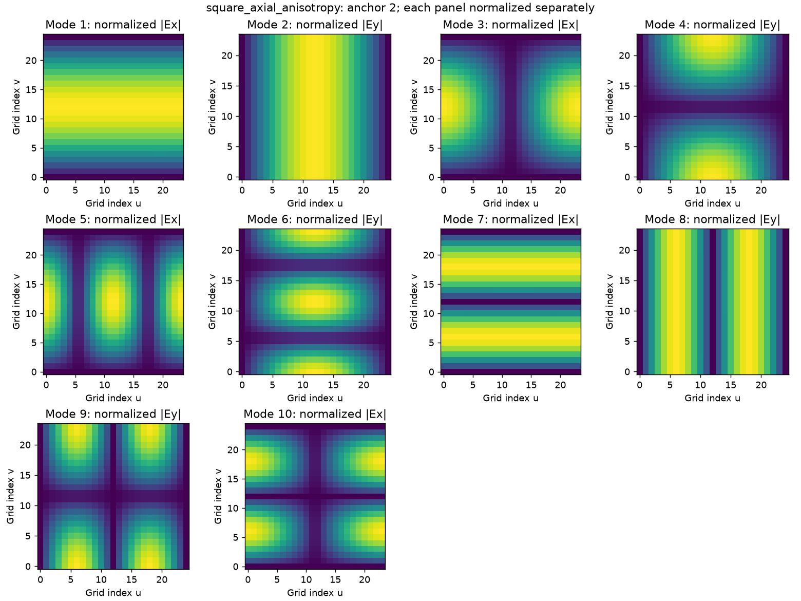

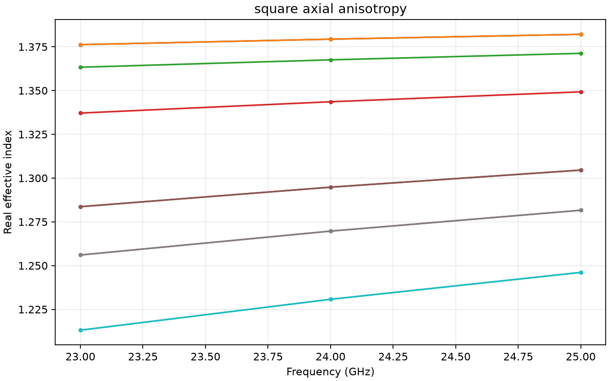

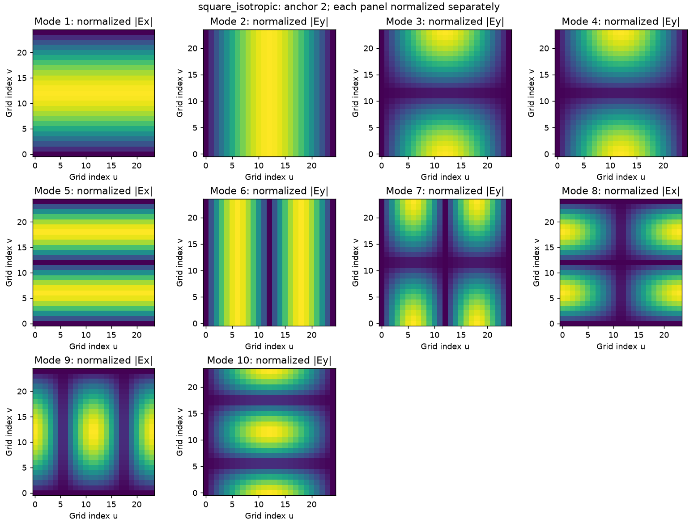

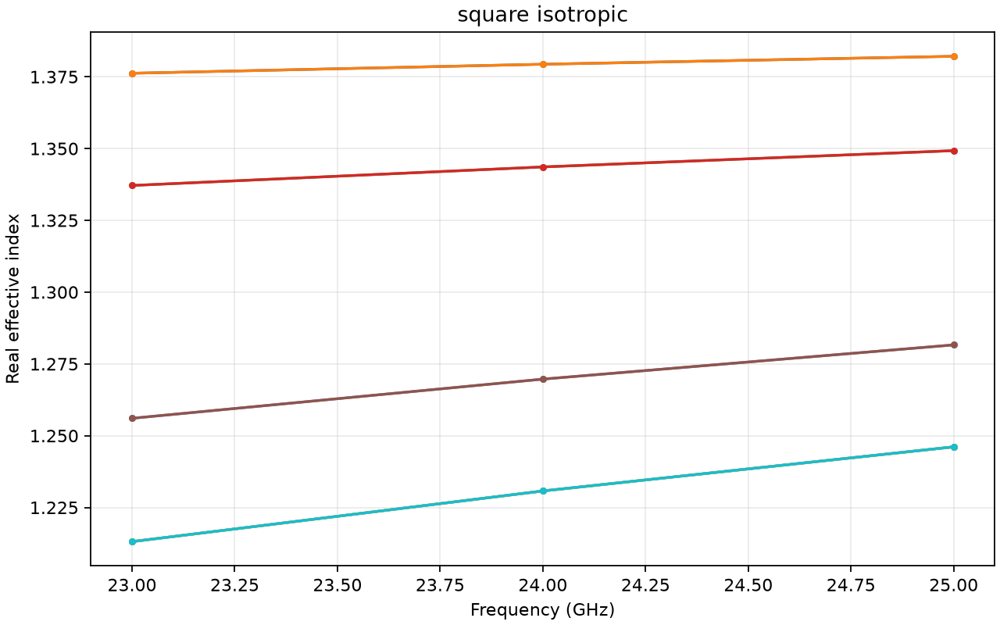

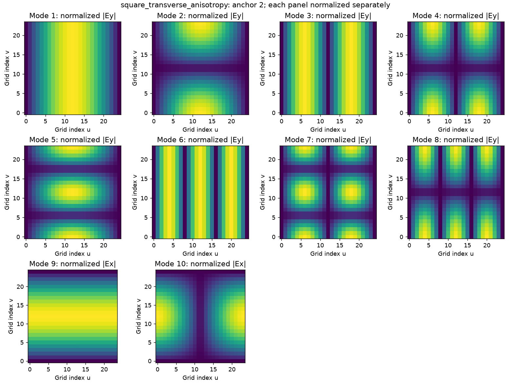

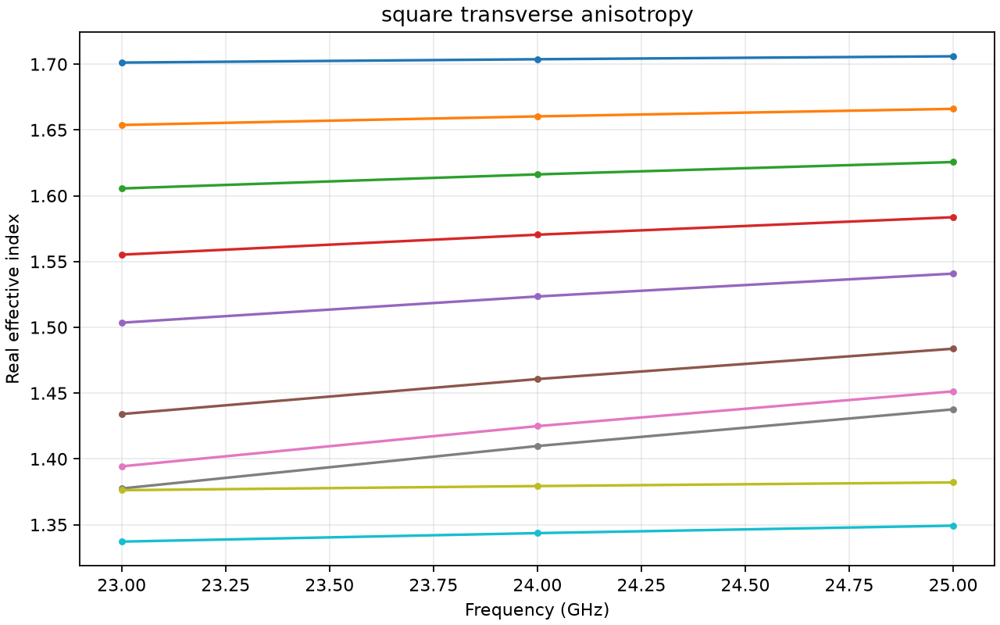
