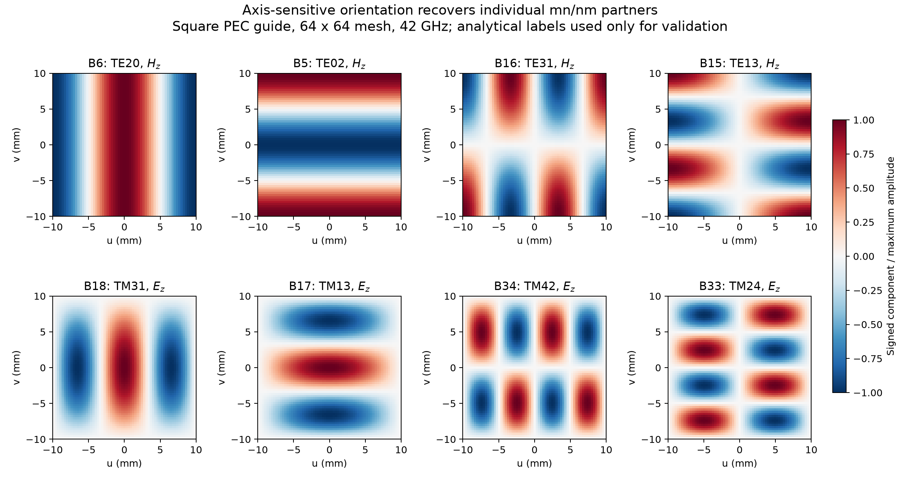
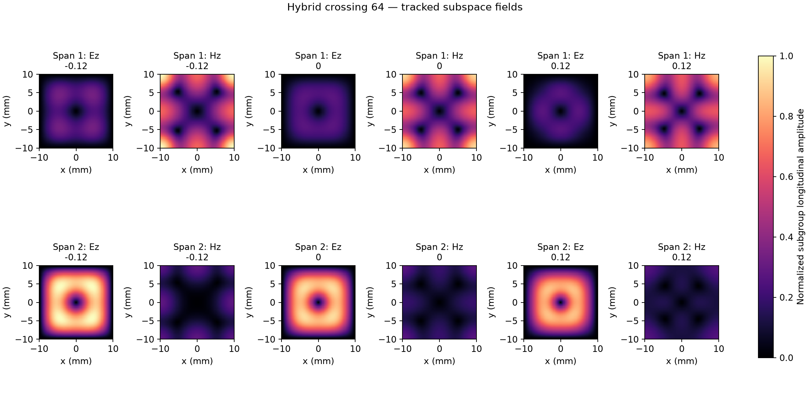
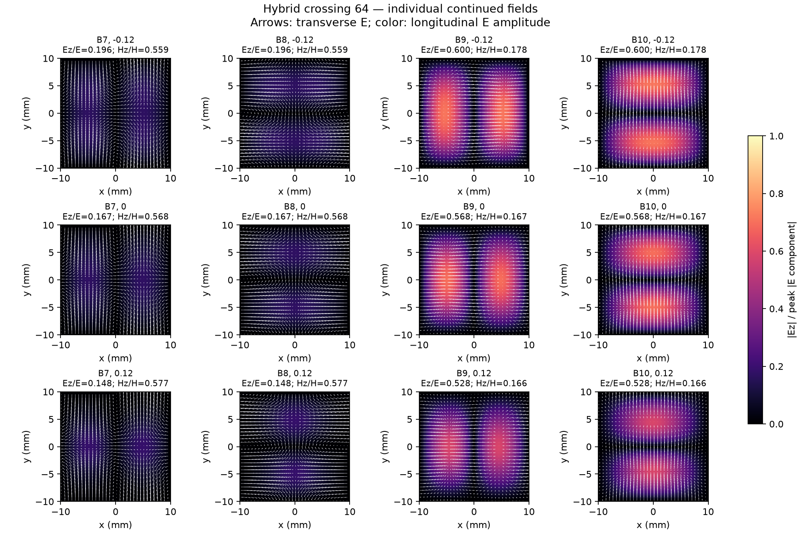

identification: longitudinal
============================

* `circular_64.json <circular_64.json>`_
* `circular_96.json <circular_96.json>`_
* `hybrid_crossing_64.json <hybrid_crossing_64.json>`_
* `manifest.json <manifest.json>`_
* `rectangular_48.json <rectangular_48.json>`_
* `rectangular_64.json <rectangular_64.json>`_
* `square_48.json <square_48.json>`_
* `square_64.json <square_64.json>`_

.. image:: hybrid_crossing_64_tracking.png
   :alt: hybrid crossing 64 tracking
   :width: 100%
