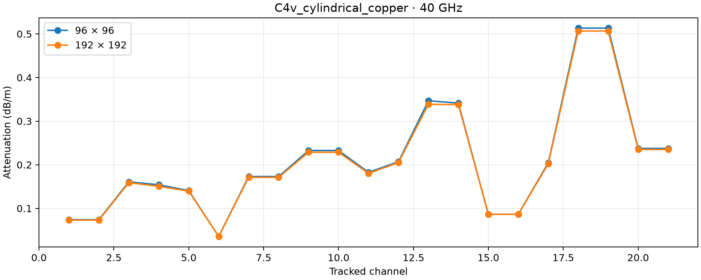
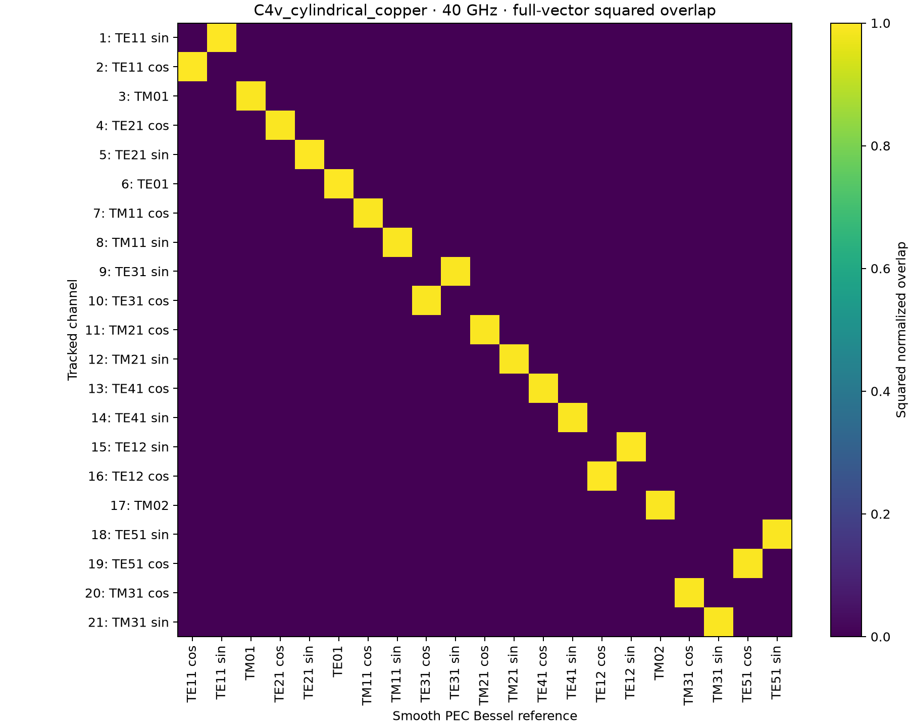
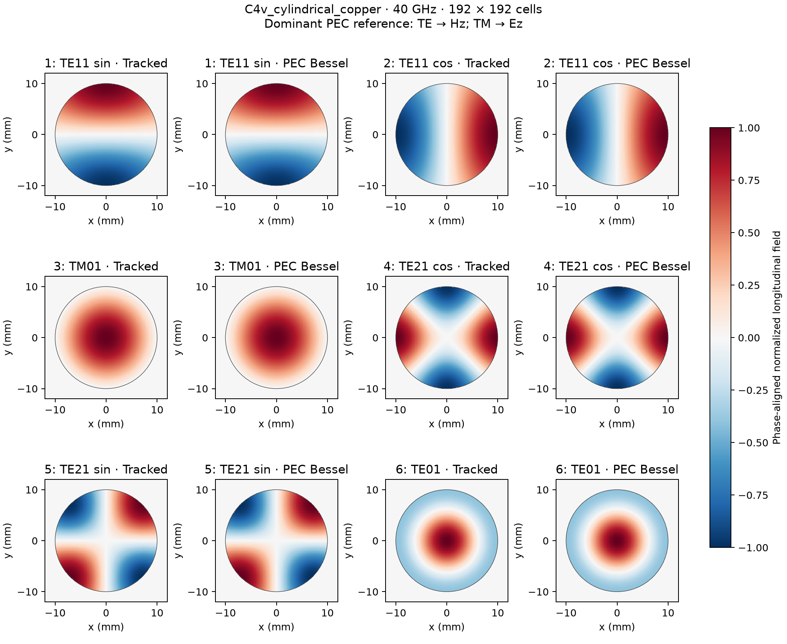
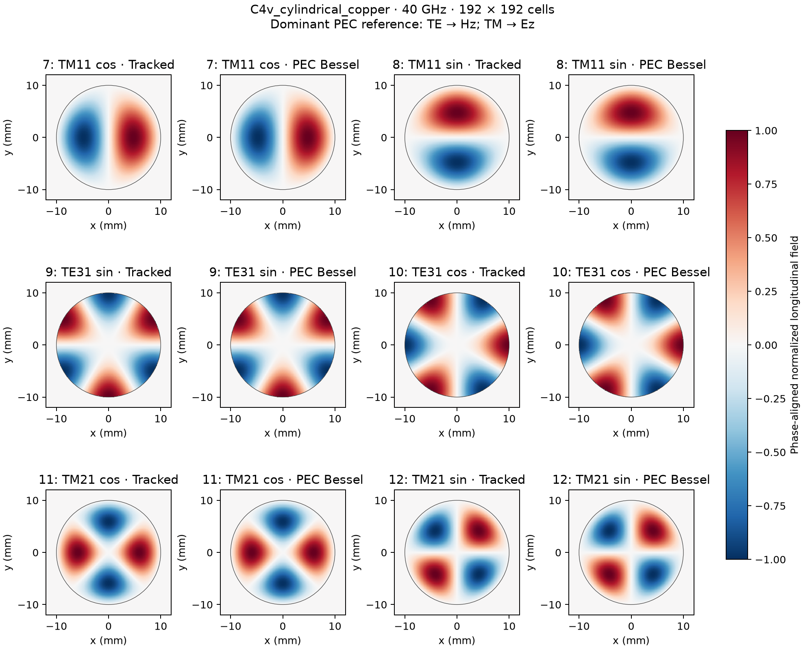
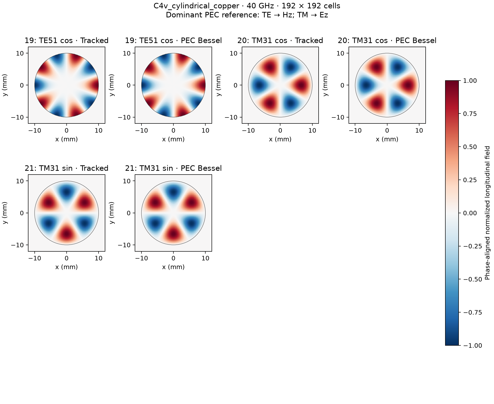

profiles: C4v cylindrical copper
================================

* `results.json <results.json>`_

.. image:: C4v_cylindrical_copper_convergence.png
   :alt: C4v cylindrical copper convergence
   :width: 100%

.. image:: C4v_cylindrical_copper_profiles_3.png
   :alt: C4v cylindrical copper profiles 3
   :width: 100%

