subspaces: general
==================

* `arbitrary_multiplicity.json <arbitrary_multiplicity.json>`_
* `c4v_dielectric_hybrid.json <c4v_dielectric_hybrid.json>`_
* `c4v_metallic_quartet.json <c4v_metallic_quartet.json>`_
* `dielectric_hybrid_pair_crossing.json <dielectric_hybrid_pair_crossing.json>`_
* `manifest.json <manifest.json>`_
* `metallic_pair_crossing.json <metallic_pair_crossing.json>`_
* `persistent_metallic_quartet.json <persistent_metallic_quartet.json>`_
* `square_dielectric_core.json <square_dielectric_core.json>`_
* `summary.json <summary.json>`_
* `symmetry_summary.json <symmetry_summary.json>`_

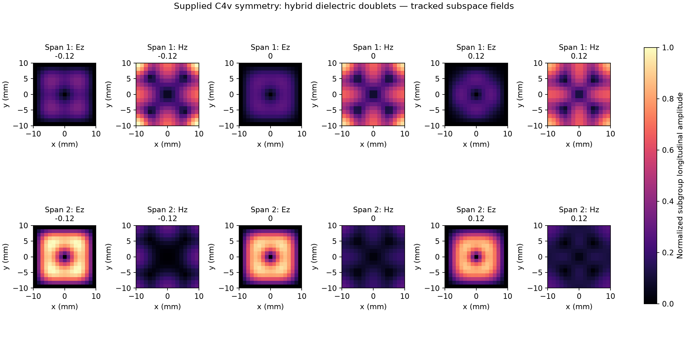

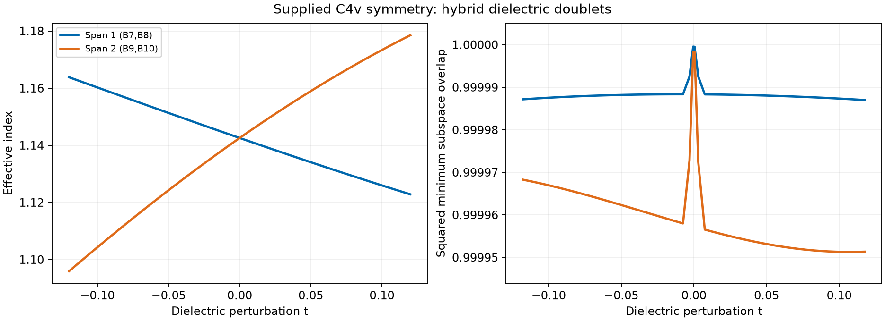

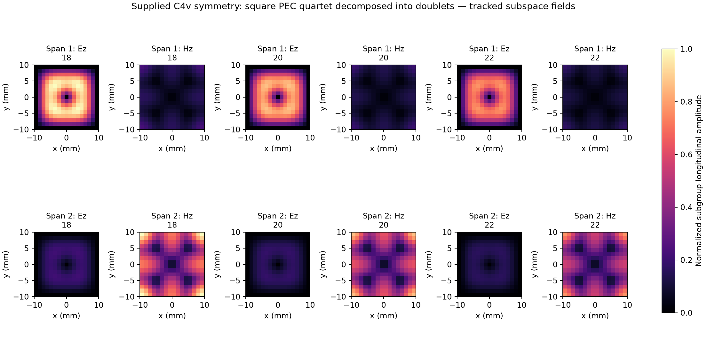

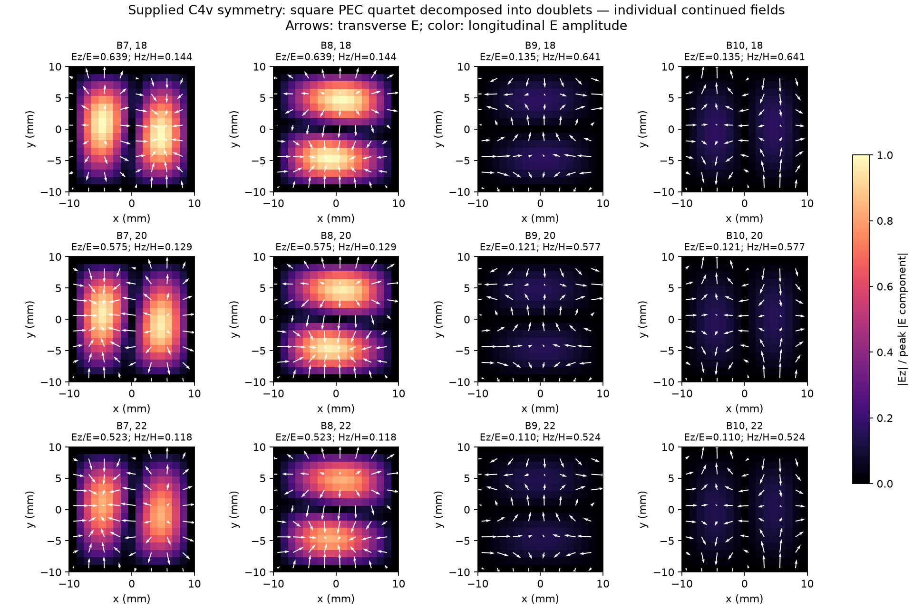

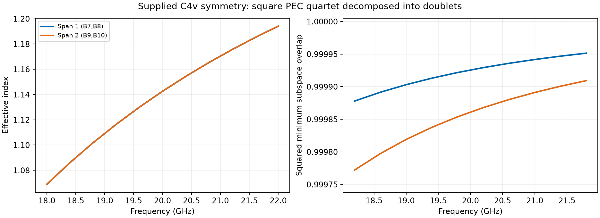

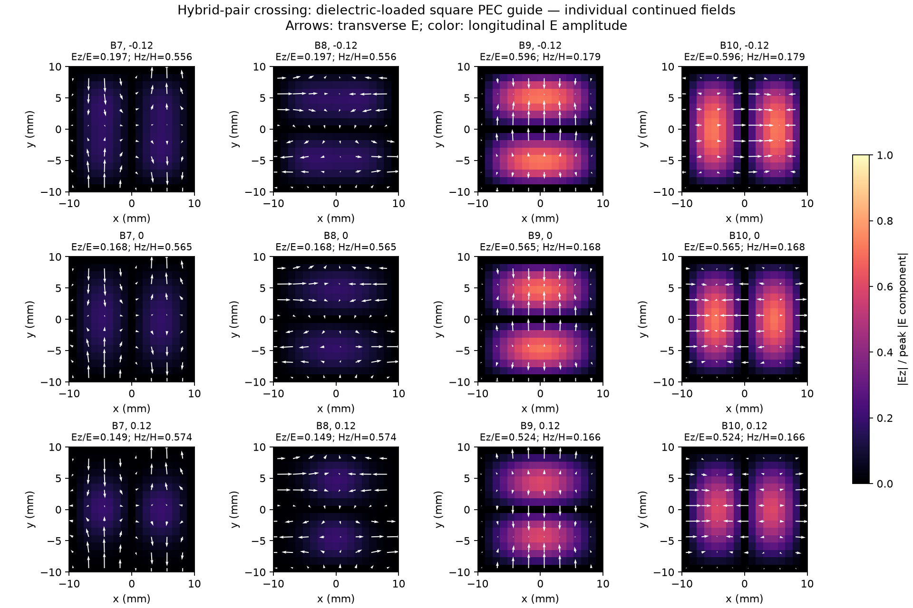

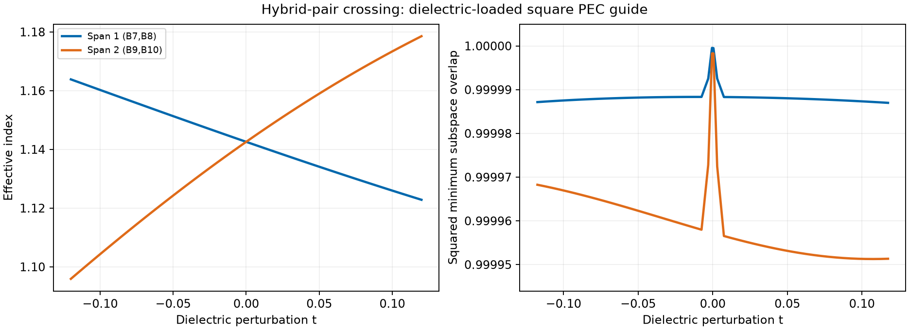

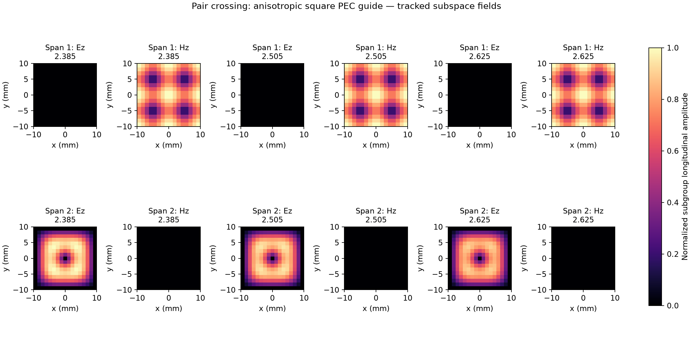

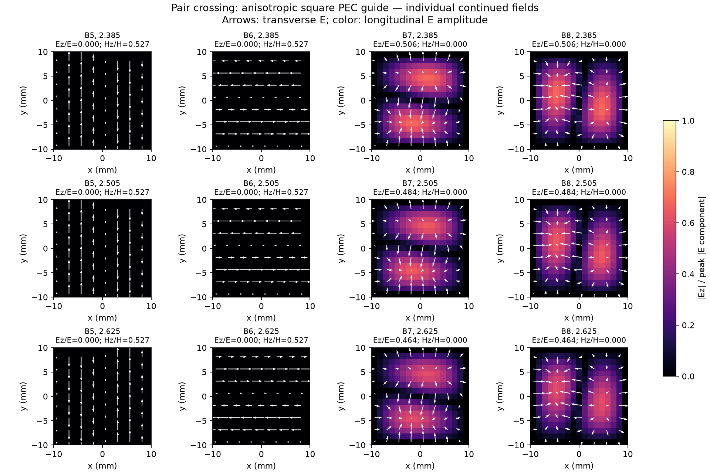

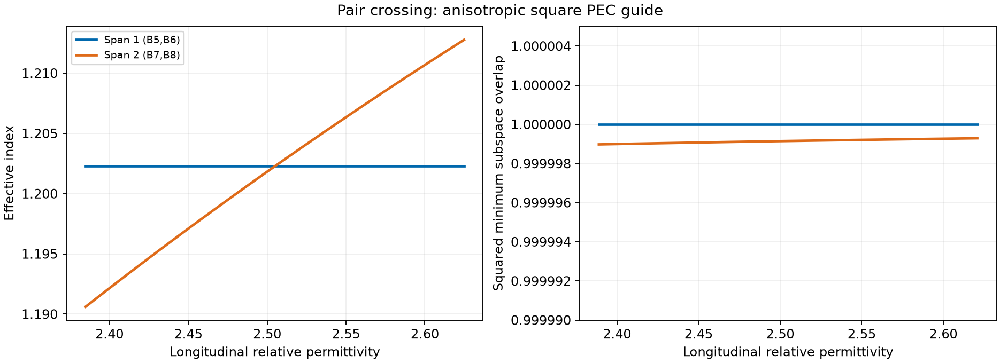

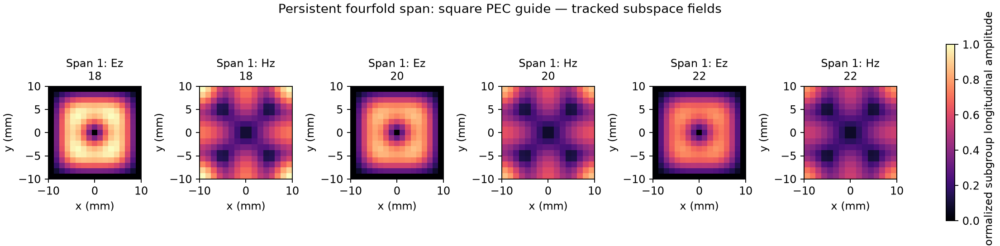

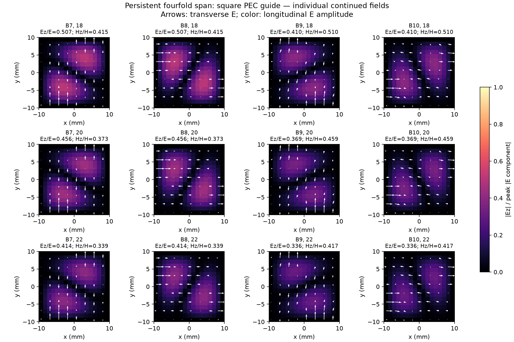

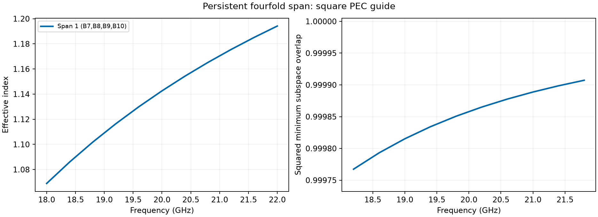

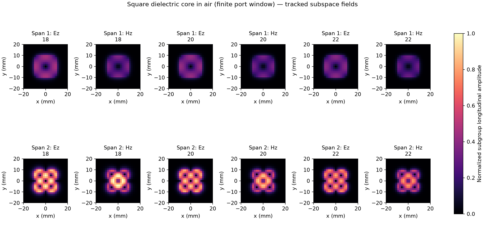

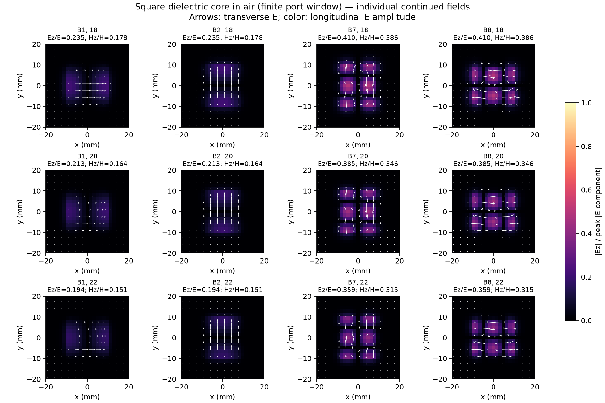

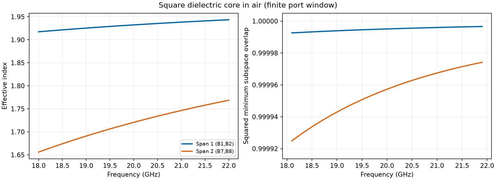
