symmetry: moment parity
=======================

* `circular_higher_order_partners.json <circular_higher_order_partners.json>`_
* `crossing_hybrid_parity_partners.json <crossing_hybrid_parity_partners.json>`_
* `fundamental_moment_alignment.json <fundamental_moment_alignment.json>`_
* `higher_order_parity_partners.json <higher_order_parity_partners.json>`_
* `manifest.json <manifest.json>`_
* `summary.json <summary.json>`_

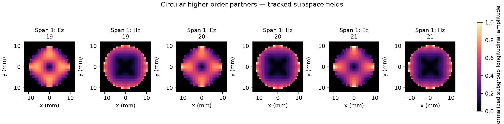

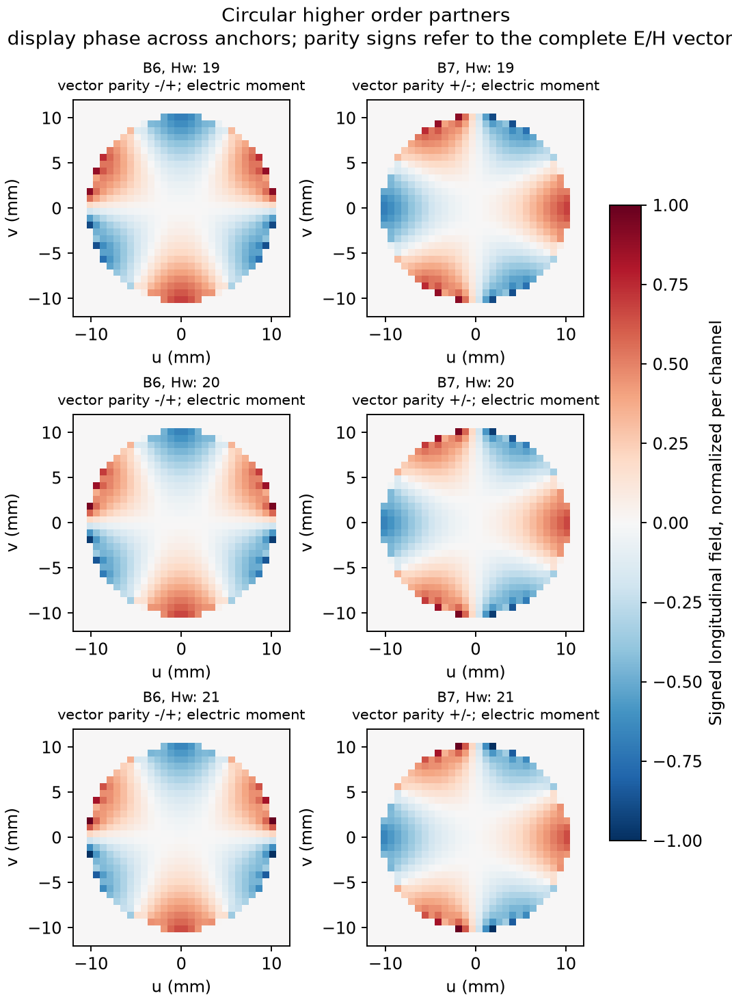

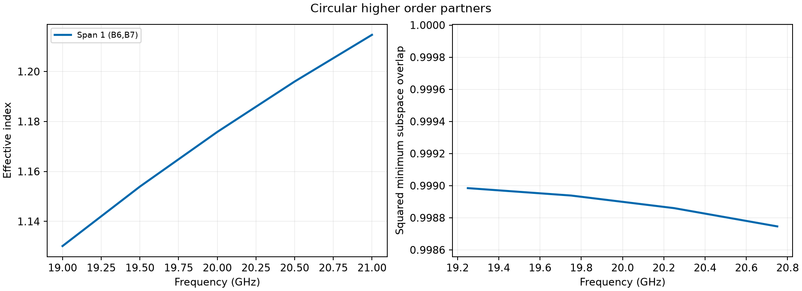

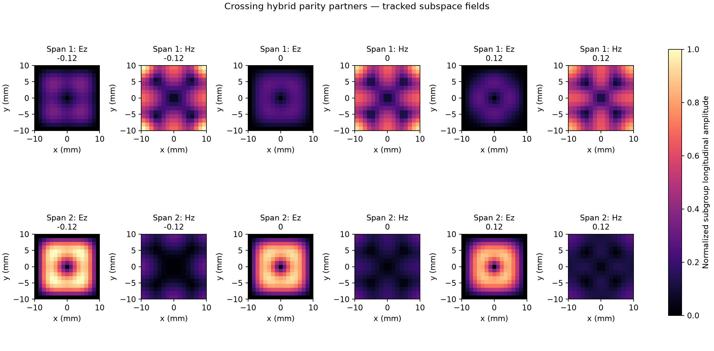

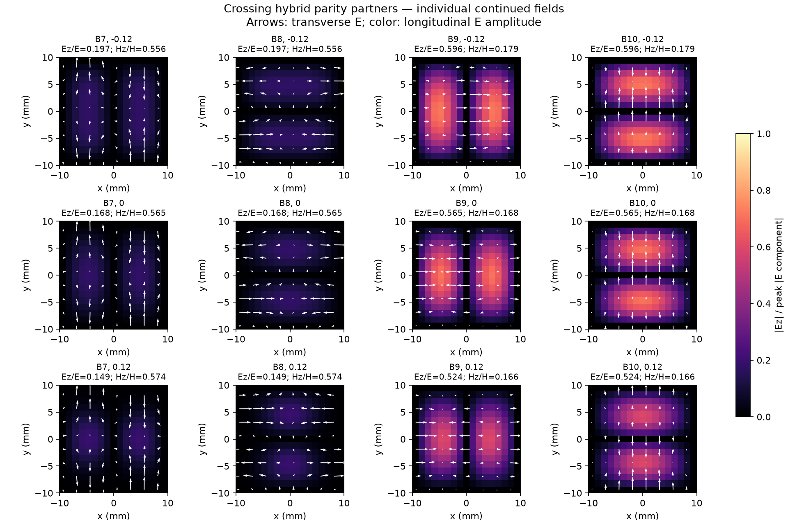

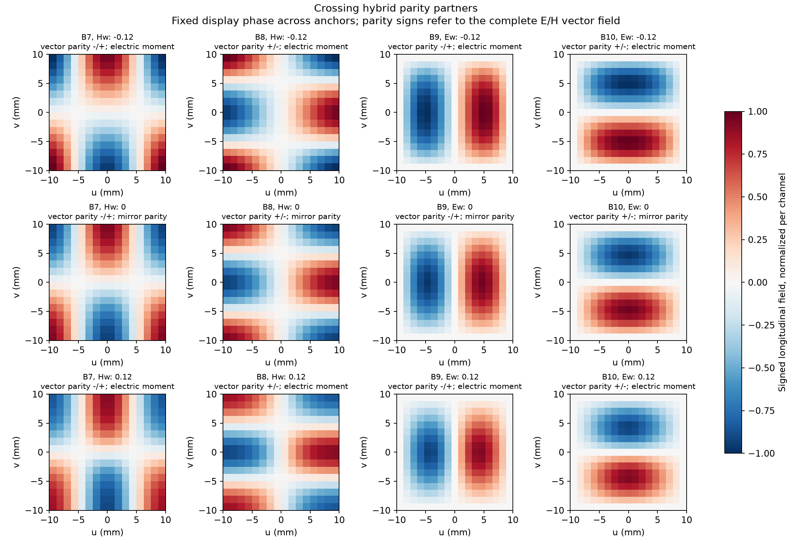

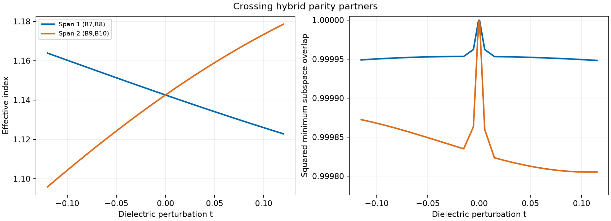

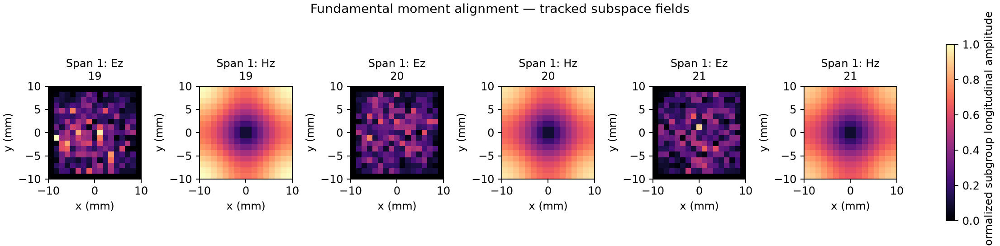

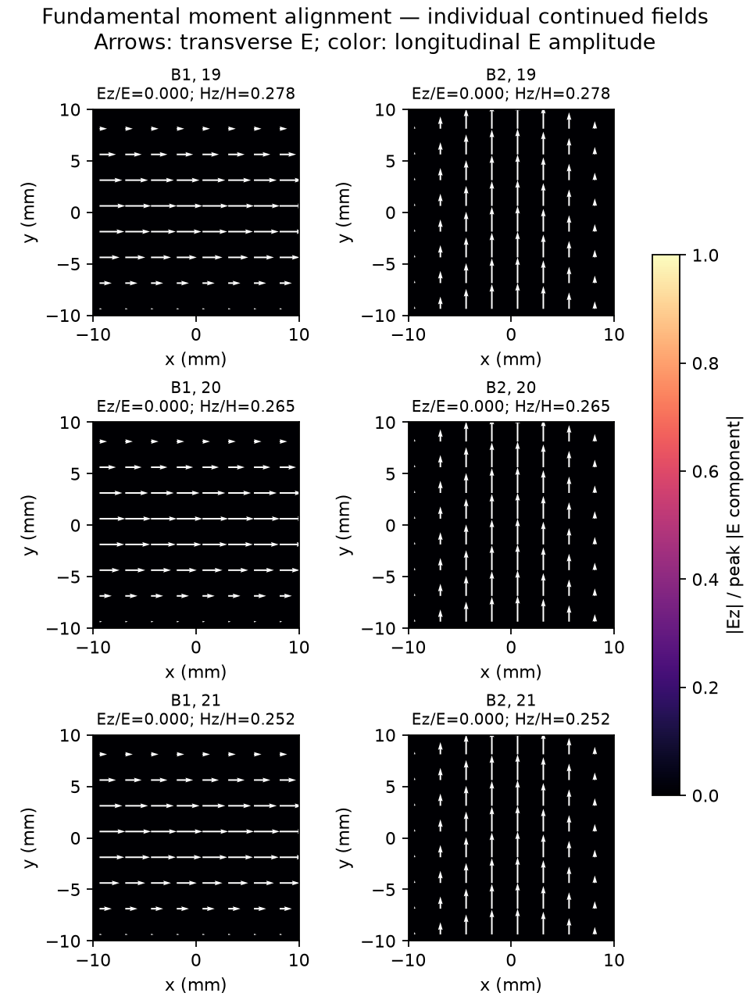

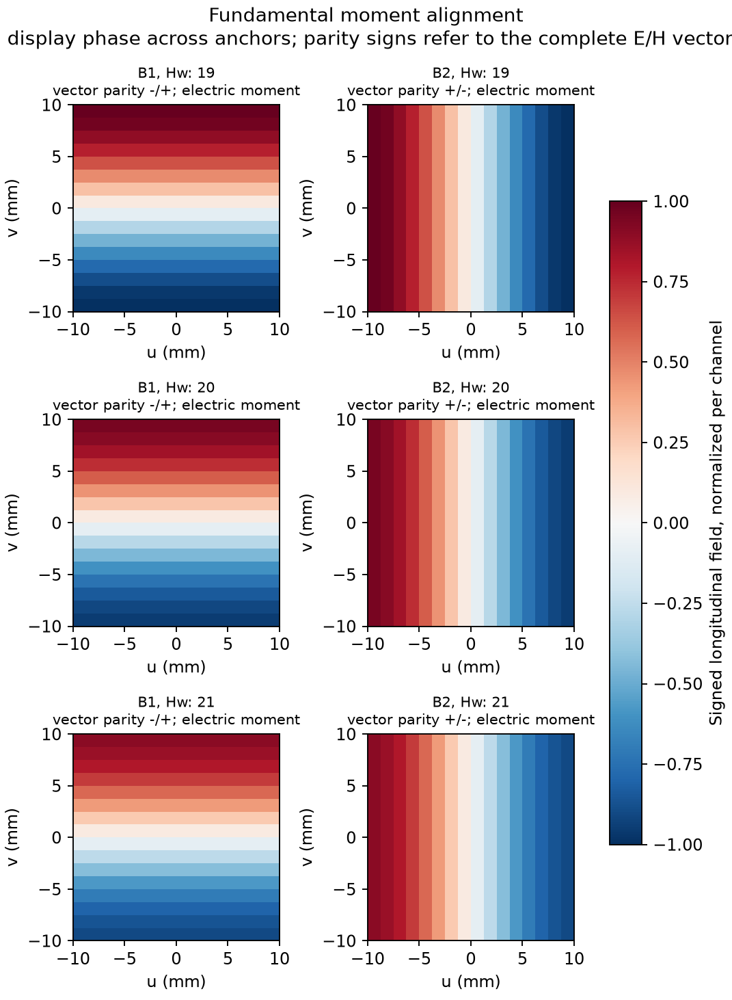

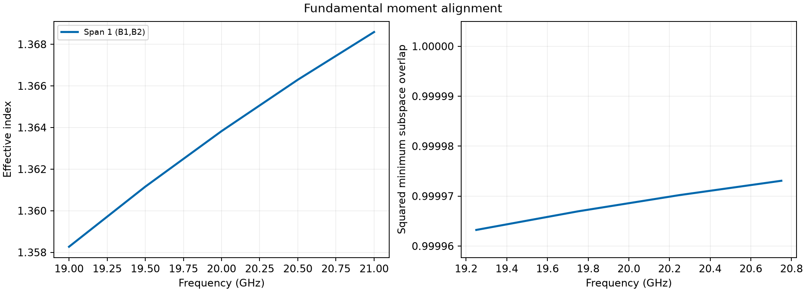

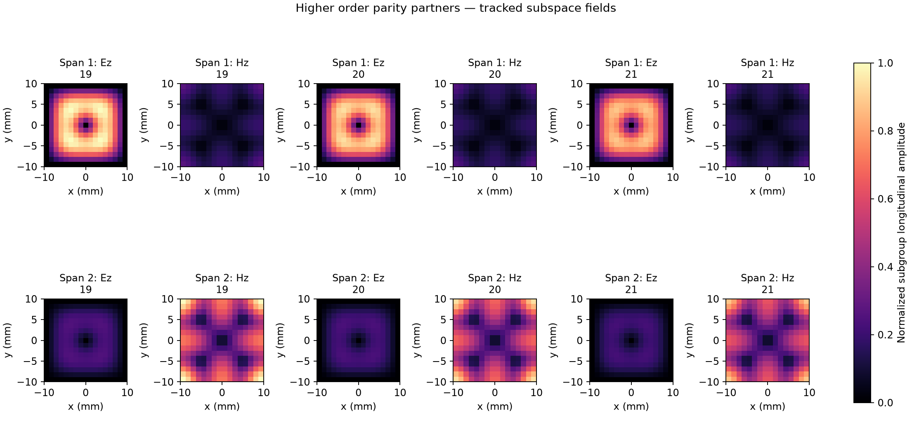

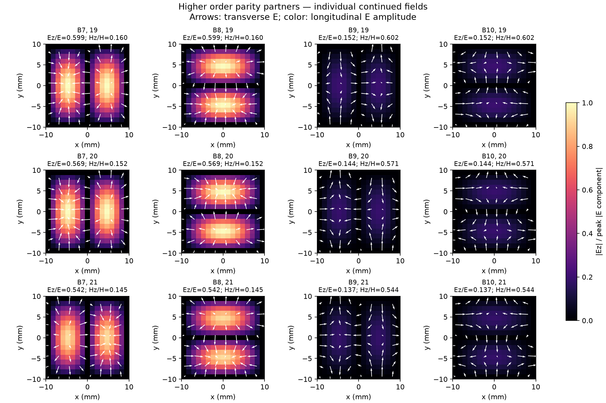

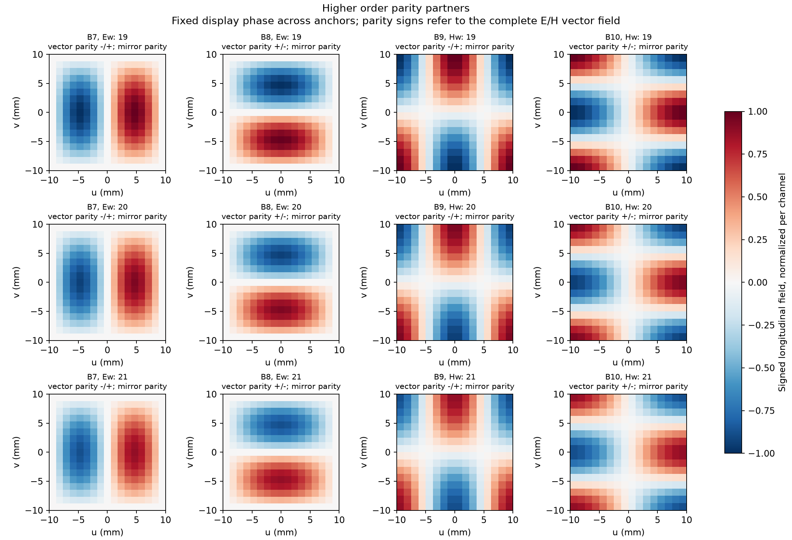

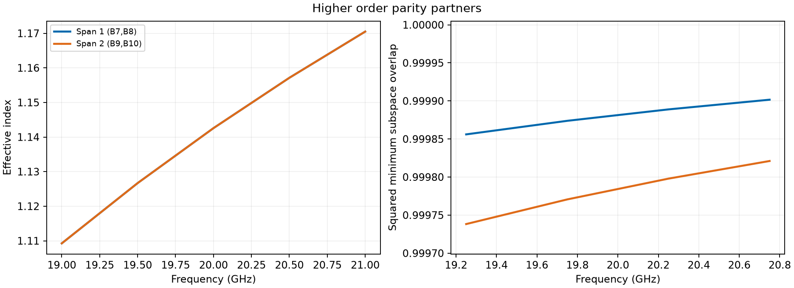
