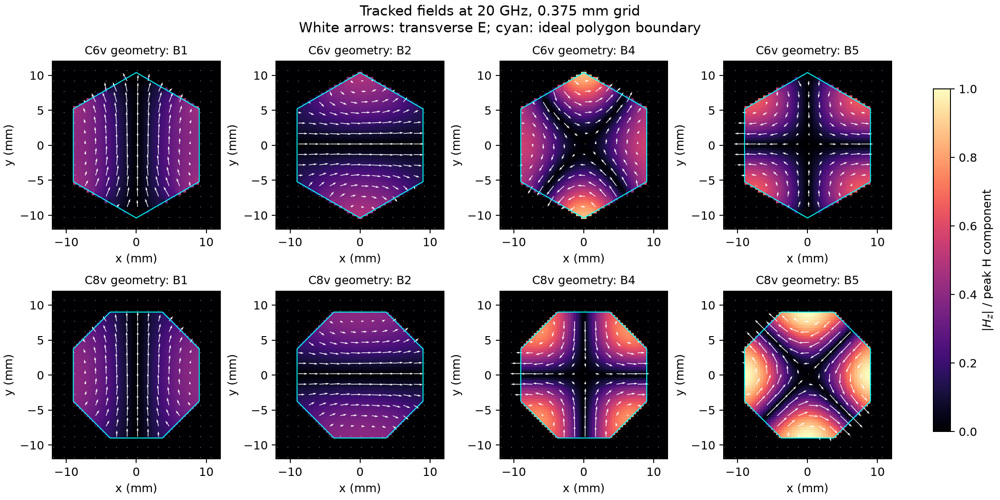

symmetry: polygons
==================

* `c6v_tracking.json <c6v_tracking.json>`_
* `c8v_tracking.json <c8v_tracking.json>`_
* `manifest.json <manifest.json>`_
* `mesh_study.json <mesh_study.json>`_
* `tracking_summary.json <tracking_summary.json>`_

.. image:: symmetry_breaking.png
   :alt: symmetry breaking
   :width: 100%

