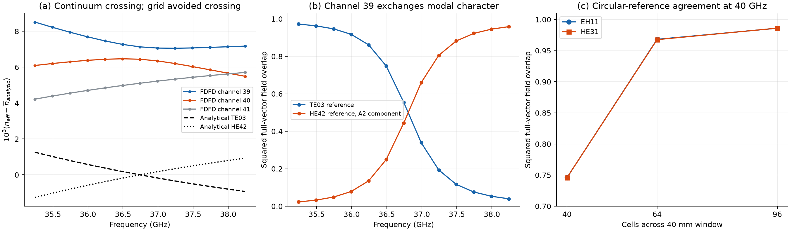

Higher-order modes, repeated irreps, and circular dielectric identities
======================================================================

The combined pipeline recovers repeatable, physically valid individual FDFD channels in all completed higher-order and controlled-crossing cases. It does not generally recover a pure smooth-circle analytical mode from a C4v staircase eigenmode. The new evidence includes an actual same-irrep avoided crossing and a failed attempt to force its branches back into pure analytical identities.

Higher-order scope and results
------------------------------

The six square/circular PEC/copper/dielectric cases were repeated at 79, 80, and 81 GHz, requesting 60 modes from 80 candidates on 40-by-40 and 64-by-64 meshes. Each bank was tested as solved and after two independent random complex basis changes within exact eigenspaces (seeds 131 and 982). Copper uses conductivity 5.96e7 S/m. Geometries and material profiles match the earlier combined audit: 20 mm air-filled square conductor guide, 10 mm radius air-filled circular conductor guide in a 24 mm window, or epsilon=4 square/circular dielectric cores in air inside a 40 mm PEC truncation window. Circular PEC template diagnostics were extended through angular order 16 and radial order 8. These diagnostics do not select or alter the numerical fields.

All twelve banks passed the automated checks in verification.json: positive full power, propagating selected modes, Maxwell residual below 1e-7, same-channel recovery under random raw-basis changes, C4v-certified degenerate groups, and no unresolved Procrustes transport or rejected scalar-separation trial. Reference-pattern scores are separate evidence about smooth-guide modal character and are not used as pass/fail substitutes for physical residuals.

.. list-table:: Higher-order audit at 79, 80, and 81 GHz
   :header-rows: 1

   * - Case / cells
     - Channels
     - Max Maxwell residual
     - Min reference-pattern score
   * - square_PEC_40
     - 60
     - 1.355e-14
     - 1.000000
   * - square_PEC_64
     - 60
     - 2.326e-14
     - 1.000000
   * - circular_PEC_40
     - 60
     - 7.893e-15
     - 0.583499
   * - circular_PEC_64
     - 60
     - 1.571e-14
     - 0.519648
   * - square_copper_40
     - 60
     - 4.059e-10
     - 0.998045
   * - square_copper_64
     - 60
     - 3.854e-10
     - 0.999557
   * - circular_copper_40
     - 60
     - 7.237e-12
     - 0.579620
   * - circular_copper_64
     - 60
     - 1.161e-11
     - 0.524552
   * - square_dielectric_40
     - 60
     - 1.625e-15
     - hybrid: no PEC template
   * - square_dielectric_64
     - 60
     - 3.190e-15
     - hybrid: no PEC template
   * - circular_dielectric_40
     - 60
     - 1.672e-15
     - hybrid: no PEC template
   * - circular_dielectric_64
     - 60
     - 3.180e-15
     - hybrid: no PEC template

The higher circular PEC modes show why discrete identity and continuum identity differ. At 80 GHz on the 64-cell grid, channels 42 and 44 have best longitudinal Bessel scores of approximately 0.529 for TE81 and 0.520 for TE42 respectively. Both scalar patterns can carry the same C4v representation and can mix in the staircase eigenproblem. The pipeline still recovers these same discrete fields after arbitrary raw eigenspace rotations. The square PEC reference patterns remain individually resolved.

Controlled same-irrep crossings
-------------------------------

The dielectric-loaded square sweep used 51 material-parameter anchors from -0.12 to 0.12, including zero and +/-0.001. Two hybrid E doublets cross at an exact four-dimensional coincidence; the eigenspace at that coincidence was randomly mixed. Ten retained channels recovered the same individual fields, with minimum squared raw-basis invariance overlap 0.999999999999977 and minimum adjacent-parameter overlap 0.999937.

The higher-order square test tuned longitudinal permittivity through the exact discrete TE14/TE41--TM23/TM32 coincidence. Both pairs are C4v E. Twenty-seven anchors span epsilon_z=1.5162688024 to 1.5762688024 at 40 GHz, with epsilon_transverse=2 and 24 cells across 20 mm. The crossing is at epsilon_z=1.5462688024. Forty channels were retained. Tracked channels 23/24 remained TE41/TE14 and 25/26 remained TM23/TM32 while their raw eigenvalue ranks exchanged; all four template scores remained 1.0. Minimum raw-basis invariance overlap was 0.999999999999965, and minimum adjacent-parameter overlap was 0.99999944. Thus repeating the E label does not itself prevent physical separation when independent longitudinal information is available.

Analytical circular dielectric reference
---------------------------------------

The new oracle solves the full-vector, infinite-cladding step-index cylinder with radius 10 mm, core epsilon=4, cladding epsilon=1, and mu=1. It uses J_m radial functions in the core and decaying K_m functions in the cladding, with tangential E/H continuity. Both angular partners and all six vector components are sampled at the native Yee locations. TE/TM and HE/EH characteristic roots are independently calculated; no weak-guidance LP approximation is used. The adopted field and characteristic equations are equations 5.1--5.6 of the `Virginia Tech reference <https://vtechworks.lib.vt.edu/bitstream/handle/10919/30522/jb-chap5.pdf>`_, using its complete-cylinder equations without the additional wedge boundary condition.

Eleven oracle tests verify interface continuity, including normal D/B, root ordering/certification, and second-order convergence of the sampled full-vector Maxwell curl relation away from the material interface. All eleven passed.

The numerical comparison covers the first 20 channels at 20 GHz and 40 channels at 40 GHz on 40, 64, and 96 cells across the 40 mm window. Comparisons use squared normalized overlap of the complete [E, Z0 H] field and effective-index error. At 40 GHz, the EH11/HE31 individual overlaps improve from about 0.746 at 40 cells to 0.968 at 64 cells and 0.986 at 96 cells. Their combined four-dimensional span has minimum principal overlap 0.987706, 0.998439, and 0.999553 respectively. This identifies mixing of nearby equivalent E copies as the main coarse-grid discrepancy for these modes.

Agreement is not uniform or monotonic across all higher modes. At 96 cells and 40 GHz, the worst of the first 40 individual overlaps is 0.943516 for one HE42 partner, with appreciable TE03 content. At 20 GHz, the minima over the first 20 channels are 0.964417, 0.987144, and 0.985232 at 40, 64, and 96 cells. Maximum relative effective-index errors at 20 GHz are 2.485%, 0.363%, and 0.418%; at 40 GHz they are 1.455%, 0.424%, and 0.226%. Staircase-interface changes and same-symmetry mixing affect individual modes differently. The per-channel files retain the assigned analytical family, alternatives, field overlaps, and propagation-constant errors.

An observed circular same-irrep avoided crossing
----------------------------------------------

In the smooth circular dielectric problem, TE03 and HE42 cross at 36.742026086 GHz. Under C4v, TE03 and one HE42 component both transform as A2; the other HE42 component is A1. A 64-cell FDFD sweep over thirteen frequencies from 35.242 to 38.242 GHz follows three channels through this region. The two A2 eigenvalues exhibit an avoided crossing and exchange modal character. Channel 39 changes from about 97.2% squared overlap with the TE03 reference to about 95.9% overlap with the HE42 A2 reference. At the analytical crossing, it is approximately 55.5% TE03 and 44.4% HE42 by these overlap diagnostics. The complementary channel exchanges in the opposite direction. These squared sampled overlaps describe reference projections; they are not exact power fractions.

The pipeline retains the valid numerical eigenbranches: minimum adjacent-frequency overlap is 0.951889, maximum Maxwell residual is 3.21e-14, and no unresolved fallback is needed. The combined three-channel span remains above 0.991916 overlap with its analytical reference span. Increasing the outer window from 40 to 60 mm at fixed 0.625 mm spacing changes the fields by less than 1.13e-10 in squared overlap and changes effective index by less than 8.99e-11 relatively. The effect remains in the discretized circular guide after removing the outer-window contribution. This control does not separate staircase-interface error from Cartesian bulk discretization.

A counterfactual experiment projects the analytical TE03 and HE42 A2 references into the two numerical eigenmodes at the crossing, then optimizes the effective index of each resulting field to minimize the full Maxwell residual. The reference overlaps improve to 0.994216 and 0.997034, but the best residuals are 1.274e-4 and 1.236e-4, compared with about 8e-15 for the original eigenmodes. Both violate the production 1e-7 criterion. Forcing pure analytical identities would therefore discard the physical validity constraint.

Conclusion and scope
--------------------

The combined criteria suffice for the tested numerical identities, including repeated-E exact crossings. Pure smooth-circle TE/TM/HE/EH labels need not remain eigenmodes of a C4v FDFD problem near a same-irrep interaction. Preserve the physical eigenbranches there, and describe their analytical modal content and the combined subspace separately. A certified E pair remains the permitted case for user electric-moment polarization mixing, subject to the existing moment and physical checks; that control does not undo hybridization between distinct numerical eigenvalues.

This audit adds reference/audit scripts, tests, plots, and results. It makes no additional runtime-pipeline changes. The sweep is finite; it does not prove completeness at every order or parameter value. Reports, source hashes, seeds, logs, transforms, residuals, and overlaps are retained in the neighboring higher_identity, crossing_identity, analytical_dielectric_identity, circular_crossing_identity, circular_crossing_window, and circular_forced_unmix output directories dated 20261024.
